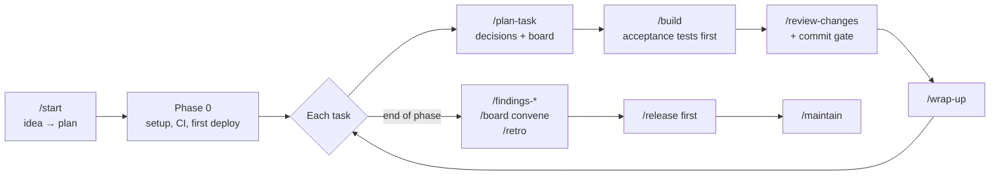

<p align="center">
  <picture>
    <source media="(prefers-color-scheme: dark)" srcset="kit/assets/banner-dark.svg">
    
  </picture>
</p>

<p align="center">
  <a href="kit/CHANGELOG.md"></a>
  <a href="LICENSE"></a>
  
  
  
</p>

<p align="center">
  <a href="README.md">Türkçe</a> · <b>English</b> · <a href="https://burakdogrul.github.io/TillerHand/kit/guide.html"><b>Read the guide →</b></a>
</p>

<p align="center">
  <a href="#step-by-step-for-beginners">Step by step</a> ·
  <a href="#quick-start">Quick start</a> ·
  <a href="#how-it-works">How it works</a> ·
  <a href="#expert-board">Board</a> ·
  <a href="#guardrails">Guardrails</a> ·
  <a href="#commands">Commands</a> ·
  <a href="#license">License</a>
</p>

---

**TillerHand** is a starter kit that takes a product from idea to production and maintenance with [Claude Code](https://claude.com/claude-code). The AI writes the code; **you make the decisions**. At every important step it lays out the options, when each one is the better choice, and what it recommends. An **expert board** reviews the work, **guardrails** stop dangerous actions before they happen, and the project always stays in a **clean folder structure**.

> The kit's commands, prompts and documents are in Turkish.

| | |
|---|---|
| **Question-driven** | Product, technical, design, data, security and cost decisions come as reasoned options. Design questions come with visual previews. |
| **Expert board** | Product, Architect, Security, UX, Privacy, QA and other members review the plan, each task, each commit and each phase. |
| **Tests first** | Acceptance tests are written before the code and start red. Nothing is called done without proof that it works. |
| **Findings reports** | The top 20 findings for tech, business, security, UX, performance and legal; scored, with how to fix them. |
| **Guardrails** | Secrets, destructive commands, unapproved prod deploys, weakened tests and stray files are stopped before they happen. |
| **Dashboard** | `dashboard.html`: status, what needs attention, decisions, board, findings, quality, operations, usage. |
| **Usage-aware** | Reads the 5-hour and weekly limits and plans work around them. It warns; it never stops the work. |
| **Sourced facts** | Anything that changes (versions, prices, regulations) is checked against a primary source, with link and date. |
| **Rollback** | `/rollback` returns to the last working state; history is kept, unfinished work is saved. |
| **Narrator mode** | Optionally explains every change in plain language, as if to someone who doesn't code. |

## Step by step for beginners

You don't need to know how to code. Claude handles git, the terminal and installs; you describe what you want and make the choices.

**1. Setup (once)**
- Accounts: [GitHub](https://github.com) (free) and a Claude **Pro** or **Max** subscription.
- Apps: the [Claude desktop app](https://claude.com/download), [Node.js](https://nodejs.org) (LTS), [Git](https://git-scm.com/downloads).

**2. Create your project**
1. Make a folder for your project and select it in the **Code** tab of the Claude desktop app.
2. Type: `run npx tillerhand init in this folder`.
3. **Start a new session** in the same folder. The kit's commands and guardrails load in the new session.

**3. Start**

```
/start An invoicing and payment tracker for freelancers
```

Claude asks its questions one by one. **The first option is always the recommended one**; pick it if you're unsure. Already have a project? Type `/adopt` instead of `/start`: Claude scans the code, derives the docs from it and brings the project into the kit's structure step by step.

**4. Every day**

| When | What to type |
|---|---|
| Starting work | `/build` (picks up the next task and tests it) |
| Checking status | `where are we?` or `/dashboard` |
| Something breaks | `/rollback` |
| Stopping | `/wrap-up`, then `/clear` |

**Good to know**
- **Limits:** Pro has 5-hour and weekly limits. Claude warns at 90%, 95% and 99%; if a limit runs out, continue with `/build` once it resets.
- **Approval:** Database, design and cost decisions are never made without asking. Deleting data, payments and going live always need your approval.
- **Handoff:** Leaving the project to someone else? Use `/handoff`; they continue from the same point with `/handoff devral`.

## Quick start

**Requirements:** [Claude Code](https://claude.com/claude-code), Git, Node.js 18+

```bash
mkdir my-app && cd my-app
npx tillerhand init
claude
```

With git instead of npm (the kit stays in a `vibe-kit/` folder inside the project and goes into `.gitignore`):

```bash
git clone https://github.com/burakdogrul/TillerHand.git vibe-kit
node vibe-kit/kit/kit.mjs init
```

- On first launch Claude Code offers to install the kit's skill plugins; accept.
- Kit in another folder: `node <kit>/kit/kit.mjs init --project <project>`.
- For Codex or Antigravity: `npx tillerhand init --tool codex` (several: `--tool claude,codex`).
- Recommended: a code map ([codebase-memory-mcp](https://github.com/DeusData/codebase-memory-mcp)). The AI queries the code instead of reading it file by file, which saves tokens. `/start` offers to install it.

## How it works



**The `/start` wizard** turns an idea into a plan in nine steps:

| Step | What happens |
|---|---|
| 0 Setup | Profile, planning depth, dashboard, limits |
| 1 Idea | The idea is challenged and a PRD is written |
| 2 Type | Web/SaaS, mobile or backend; any AI features |
| 3 Install | The chosen type and folder map are put in place |
| 4 Stack | The type's decision catalog: database, auth, hosting… |
| 5 Architecture | Data model, roles, services, unit economics |
| 6 Board | The expert board is set up (cost is shown first) |
| 7 Design | Style, color and type chosen from visual previews |
| 8 Roadmap | Prioritized tasks, each led by its acceptance tests |
| 9 Wrap-up | Summary and the first task |

**Decision protocol:** Each decision point offers 2-4 options; the recommended one comes first, and each option says when it's the better choice and what it costs. For decisions that are hard to reverse (database, auth, payments, data model) the board weighs in first. Decisions are logged in `docs/decisions/log.md` and never asked twice.

## Expert board

Board agents are generated for your project based on its type. The board advises; if it raises a critical finding (a veto), the work isn't done until you decide.

| Type | Suggested board |
|---|---|
| Web / SaaS | Product · Architect · Security · UX · Performance · Privacy · QA |
| Mobile | Product · Architect · Security · UX · Mobile Platform · Privacy · QA |
| Backend | Product · Architect · Security · API · DevOps · QA |

| Meeting | When |
|---|---|
| Plan | End of `/plan-task` |
| Task review | End of `/build` |
| Commit | Every commit (light, diff only) |
| Phase end, launch | `/board convene`, `/release first` |

For important decisions a **council** runs: different models answer the same question independently, rank each other anonymously, and a chair writes the outcome. Code does the counting; the final call is still yours.

## Findings reports

Scans the project through an expert's eyes and writes the **top 20 findings** with evidence, a 0-100 score and a fix to `docs/findings/`. Each report is compared with the previous one and shown as a trend on the dashboard.

| Command | Perspective | Example finding |
|---|---|---|
| `/findings-tech` | Senior architect | N+1 queries, duplicated authorization checks |
| `/findings-business` | Industry expert | Missing refund rule, a feature competitors treat as standard |
| `/findings-security` | Attacker | IDOR, a key leaked to the client |
| `/findings-ux` | UX researcher | No empty state, low contrast |
| `/findings-perf` | Performance and FinOps | Large bundle, unbounded AI cost |
| `/findings-legal` | Compliance expert | Missing consent, personal data not in the inventory |
| `/findings-all` | All of them, in parallel | One summary and a shared fix plan |

## Project structure

Every project starts in this layout and stays in it. Code is organized by feature: everything for a feature lives under `features/<feature>/`.

```
.
├── .claude/          # commands, agents, hooks, board, folder map
├── .github/          # CI, Dependabot
├── docs/
│   ├── product/      # PRD, roadmap, glossary, launch
│   ├── architecture/ # overview, stack, structure
│   ├── decisions/    # decision log and ADRs
│   ├── quality/      # test plan, metrics, retros
│   ├── security/     # security checklist
│   ├── operations/   # release, deploy setup, maintenance, accounts
│   └── findings/     # findings reports
├── src/ or app/      # feature-based code
├── tests/
└── AGENTS.md · CLAUDE.md · README.md · CHANGELOG.md
```

A new file outside the map is asked about, clutter like `*.bak` and `*-old.*` is blocked, and CI checks the structure on every PR.

## Guardrails

| Guardrail | What it does |
|---|---|
| Secret guard | Blocks API keys written into code or docs |
| Destructive-command shield | Blocks `DROP`, unconditional `DELETE`, `db reset`; asks before prod deploys and rollbacks |
| Package gate | Blocks packages that don't exist; asks about very new ones or lookalikes of popular ones |
| Structure guard | Asks about files outside the map, blocks clutter files |
| Test guard | Asks before a test is deleted, skipped or weakened |
| Deterministic gate | No commit until lint, type check, tests and Semgrep have run |
| Commit gate | No commit without a board review and a green gate |
| Edit lock | With `/freeze <folder>` on, the AI writes only inside that folder |
| Scope shield | Asks before writing to a file outside the approved plan |
| Config approval | Rule and guard files never change without your approval |
| Dev/prod split | The AI and the local setup connect to the dev database only |

## Commands

| Command | What it does |
|---|---|
| `/start [idea]` | Nine-step kickoff wizard |
| `/adopt` | Brings an existing project into the kit with an alignment roadmap |
| `/plan-task [task]` | Asks the decisions, plans with the board |
| `/build [task]` | Acceptance tests first, then code, proof and board review |
| `/design` | Design decisions with visual previews |
| `/review-changes` | Independent review and security agents |
| `/fix-bug [symptom]` | Root cause, red test, fix |
| `/qa` | Runs the UI criteria in a real browser |
| `/findings-<type>` | Findings reports |
| `/board` | Sets up and convenes the board; `council <question>` runs the council |
| `/dashboard` | Dashboard |
| `/rollback` | Returns to the last working state |
| `/freeze <folder>` | Locks edits to one folder |
| `/wrap-up` | Closes the session and saves progress |
| `/release [first]` | Launch checks; `first` also walks you through hosting, domain, backups and rollback |
| `/maintain` | Weekly, monthly and quarterly maintenance |
| `/retro` | Writes lessons back to the project and the kit |
| `/handoff` | Hands the project over or takes it over |
| `/kit-update` | Updates the project to the latest kit |

Every command, setting, tool and skill is in the **[guide](https://burakdogrul.github.io/TillerHand/kit/guide.html)**.

## Codex and Antigravity

The kit is built for Claude Code; its rules, commands and guardrails also work in OpenAI Codex and Google Antigravity. There the board runs on a single model, and the question UI, status bar and commit gate are not available. Install with `node <kit>/kit/kit.mjs init --tool codex` (or `antigravity`).

## Measured

The same tasks were run with and without the kit through `claude -p` and scored with hidden tests (3.18.2, Sonnet, 6 tasks, 24 runs per condition):

- Both conditions passed every hidden test.
- The kit's tests caught **63%** of bugs deliberately injected into the code; the tests written without the kit caught **31%**.
- With the kit, tests came before the code in every run; without it, in none.

## License

[MIT](LICENSE) © 2026 Burak Doğrul
