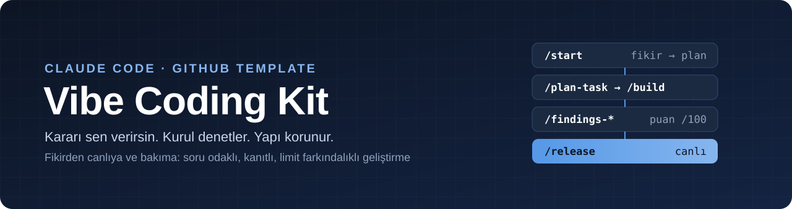
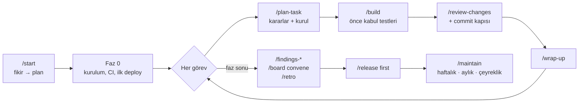
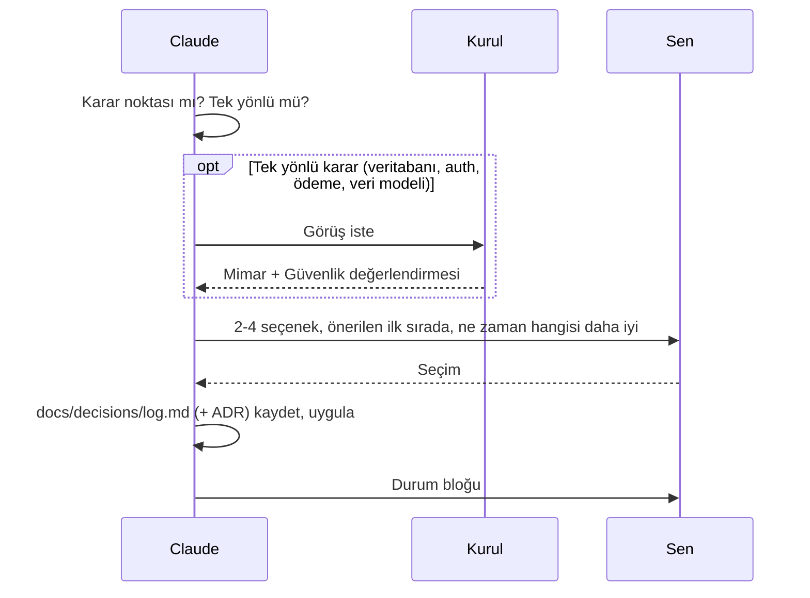
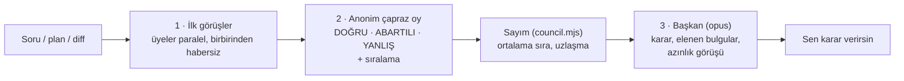
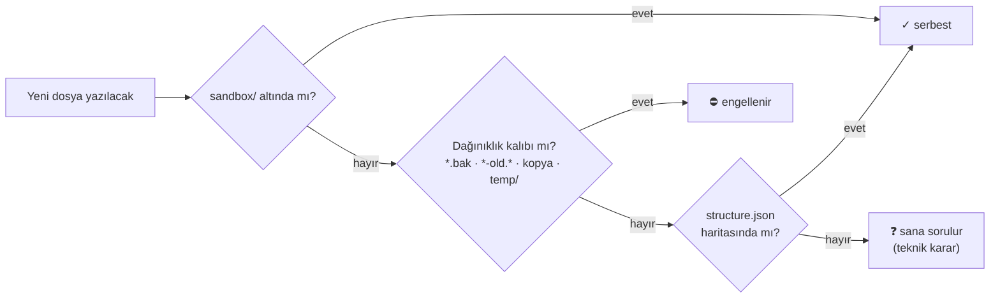
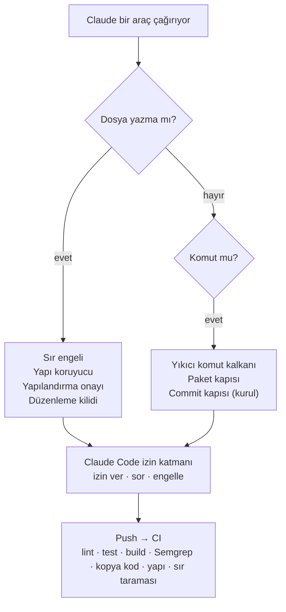

<p align="center">
  
</p>

<p align="center">
  
  
  
  
  
</p>

<p align="center">
  <a href="#-hızlı-başlangıç">Hızlı başlangıç</a> ·
  <a href="#-nasıl-çalışır">Nasıl çalışır</a> ·
  <a href="#-bulgu-raporları">Bulgular</a> ·
  <a href="#-proje-yapısı">Yapı</a> ·
  <a href="#-komutlar">Komutlar</a> ·
  <a href="#-kiti-geliştirmek">Geliştirme</a>
</p>

---

**Vibe Coding Kit**, Claude Code ile bir ürünü fikirden canlıya ve bakıma kadar götüren bir GitHub template reposudur. AI kod yazar, ama **kararları sen verirsin**: her adımda seçenekleri, hangisinin ne zaman daha iyi olduğunu ve önerisini sunar. Projeye özel bir **uzman kurulu** her işi denetler, **koruma katmanları** tehlikeli işlemleri engeller, **bulgu raporları** projeyi 100 üzerinden puanlar ve proje her an **profesyonel bir klasör yapısında** kalır.

| | |
|---|---|
| 🧭 **Soru odaklı** | Teknik, ürün, tasarım, veri, güvenlik ve maliyet kararları gerekçeli seçeneklerle sorulur. Tasarım kararları görsel önizlemeyle sorulur. |
| 🏛️ **Uzman kurulu** | Ürün, Mimar, Güvenlik, UX, KVKK, QA ve diğer üyeler planı, görevi, her commit'i ve fazı denetler. |
| 🔎 **Bulgu raporları** | `/findings-tech`, `-business`, `-security`, `-ux`, `-perf`, `-legal`: En önemli 20 bulgu, puanlı ve düzeltme yöntemli. |
| 🗂️ **Korunan yapı** | Özellik bazlı klasör haritası; harita dışı yazım sorulur, dağınıklık engellenir, CI denetler. |
| 🛡️ **Koruma katmanları** | Sır engeli, paket kapısı, yıkıcı komut kalkanı, yapılandırma onayı, düzenleme kilidi, commit kapısı, yazarken güvenlik incelemesi. |
| 📊 **Kontrol paneli** | `dashboard.html`: durum, dikkat gerektirenler, kararlar, kurul, bulgular, kalite, operasyon, limit. |
| ⏱️ **Limit farkındalığı** | 5 saatlik ve haftalık limit okunur; işler limite göre planlanır, gerekirse güvenli durulur. |
| 🌐 **Doğru kaynak** | Değişebilen bilgi birincil kaynaktan doğrulanır (kaynak ve tarihle); kütüphane dokümanı Context7'den güncel gelir. |
| 🎨 **Logo ve video** | SVG logo ve marka paketi; kod ile üretilen, 120 BPM ritimli tanıtım videosu. |
| 🔔 **Bildirim** | Claude soru sorduğunda veya uzun işi bitirdiğinde masaüstü bildirimi. |
| 🪶 **Az token** | Açılışta yaklaşık 1.900 token; dokümanlar gerektiğinde okunur; kod haritası desteği. |

## 🚀 Hızlı başlangıç

**Gereksinimler:** [Claude Code](https://claude.com/claude-code), Git, Node.js 18+

1. Bu repoda **Use this template → Create a new repository** ile yeni repo aç.
2. Klonla ve Claude Code'u başlat:

```bash
git clone https://github.com/<kullanici>/<yeni-proje>.git
cd <yeni-proje>
claude
```

3. Proje açılınca Claude Code, tanımlı skill plugin'lerini kurmayı önerir. Kabul et.
4. Başlat:

```
/start Serbest çalışanlar için fatura ve tahsilat takip uygulaması
```

<details>
<summary><b>Skill plugin'lerini kurmak</b></summary>

Proje ayarı eklentileri açar ama indirmez. `/start` onayınla hepsini proje kapsamında kurar (`node .claude/hooks/plugins-sync.mjs --kur`); ardından `/reload-plugins`. Elle kurmak istersen:

```
/plugin marketplace add juliusbrussee/caveman
/plugin marketplace add pbakaus/impeccable
/plugin marketplace add Leonxlnx/taste-skill
/plugin marketplace add nextlevelbuilder/ui-ux-pro-max-skill
/plugin marketplace add blader/humanizer
/plugin marketplace add DietrichGebert/ponytail
/plugin marketplace add mattpocock/skills
/plugin install caveman@caveman
/plugin install impeccable@impeccable
/plugin install taste-skill@taste-skill
/plugin install ui-ux-pro-max@ui-ux-pro-max-skill
/plugin install humanizer@humanizer
/plugin install ponytail@ponytail
/plugin install mattpocock-skills@mattpocock
```
</details>

<details>
<summary><b>Önerilen: kod haritası (codebase-memory-mcp)</b></summary>

AI kodu dosya dosya okumak yerine sorgular; proje büyüdükçe ciddi token tasarrufu sağlar. `/start` kurmak isteyip istemediğini sorar. Kurulumu kendi terminalinde yaparsın ([kaynak](https://github.com/DeusData/codebase-memory-mcp)):

```powershell
# Windows (PowerShell)
Invoke-WebRequest -Uri https://raw.githubusercontent.com/DeusData/codebase-memory-mcp/main/install.ps1 -OutFile install.ps1
Unblock-File .\install.ps1
.\install.ps1
```

```bash
# macOS / Linux
curl -fsSL https://raw.githubusercontent.com/DeusData/codebase-memory-mcp/main/install.sh | bash
```
</details>

## 🧭 Nasıl çalışır



### `/start` sihirbazı

| Adım | Ne olur | Örnek soru |
|---|---|---|
| 0 Hazırlık | Ortam, skill, limit, kod haritası | "Impeccable kurulu değil. Kurup devam edelim mi?" |
| 1 Fikir | Fikir sorgulanır → PRD | "İlk sürümde hangi özellikler olsun?" (çoklu seçim) |
| 2 Tip | Web/SaaS, mobil veya backend; AI özelliği var mı | "Kullanıcın masa başında çalışıyor; web öneriyorum. Uygun mu?" |
| 3 Kurulum | Seçilen tip ve yapı haritası yerleşir, `kit/` silinir | - |
| 4 Teknoloji | Tipin karar kataloğu (10-12 karar) | "Veritabanı: Supabase / Neon + Better Auth / Firebase?" |
| 5 Mimari | Veri modeli, roller, servisler, hesaplar, birim ekonomisi | "Silinen fatura çöp kutusuna mı gitsin?" |
| 6 Kurul | Uzman kurulu ve model dağılımı | "Kurulda kimler olsun?" |
| 7 Tasarım | Görsel önizlemelerle stil, renk, yazı tipi | "Bu üç açılış sayfasından hangisi?" |
| 8 Yol haritası | Kabul testi önce gelen görevler, öncelik | "Faz 1'de hangi özellikle başlayalım?" |
| 9 Kapanış | Özet, pano, ilk görev | - |

### Karar protokolü



"Tasarımda sorma" dersen sadece o konu kapanır ve o konudaki kararlar "otomatik" olarak kaydedilir; `/ask-mode on` ile tekrar açılır. Veri silme, prod deploy ve para harcatan işlemler her zaman onay ister.

## 🏛️ Uzman kurulu

Seçilen ürün tipine göre senin projende özelleştirilmiş ajanlar (`.claude/agents/board-*.md`) oluşturulur. Kurul danışmandır; kritik bulguda (RET) iş bitmez ve sana sorulur.

| Tip | Önerilen kurul |
|---|---|
| Web / SaaS | Ürün · Mimar · Güvenlik · UX · Performans · KVKK · QA (+ DevOps, AI) |
| Mobil | Ürün · Mimar · Güvenlik · UX · Mobil Platform · KVKK · QA (+ DevOps, AI) |
| Backend | Ürün · Mimar · Güvenlik · API · DevOps · QA (+ KVKK, AI) |

| Toplantı | Ne zaman | Kim | Model |
|---|---|---|---|
| Plan | `/plan-task` sonunda | Ürün + Mimar + ilgililer | üyenin modeli |
| Görev sonu | `/build` sonunda | ilgili en fazla 3 üye | üyenin modeli |
| Commit | Her commit (hook zorunlu kılar) | ilgili en fazla 2 üye, sadece diff | haiku |
| Faz sonu, canlıya alma | `/board convene`, `/release first` | tüm kurul | üyenin modeli |

### Konsey (üç aşama)

Karpathy'nin [llm-council](https://github.com/karpathy/llm-council) yapısı kurula uyarlandı. Plan, faz sonu ve canlıya alma toplantıları, RET çıkan görevler ve tek yönlü kararlar (veritabanı, auth, ödeme, veri modeli) üç aşamadan geçer. Görev sonu ve commit toplantıları limit için tek aşamalı kalır.



- **Karar konseyi:** 3 danışman (haiku, sonnet, opus) aynı soruyu cevaplar ve birbirini sıralar. Sana sorulan sorudaki "(Önerilen)" seçenek konseyden gelir; her seçenekte konsey oyu ve azınlık görüşü yazar. Elle çağırmak için: `/board council <soru>`.
- **Güvenceler:**
  - Sayımı kod yapar, model sayıyı değiştiremez.
  - Başkan tartışmalı bir kritik bulguyu kendi başına eleyemez, sana sorar.
- **Nerede görünür:** Tutanaklar `docs/workflow/council/` klasörüne yazılır. Panonun Kurul sekmesinde uzlaşma, toplu sıralama ve karar görünür.

## 🔎 Bulgu raporları

Projeyi bir uzman gözüyle tarar ve en önemli **en fazla 20 bulguyu** kanıtla, puanla ve nasıl düzeltileceğiyle `docs/findings/<tür>/` altına yazar. Her rapor bir öncekiyle karşılaştırılır (yeni / devam / kötüleşti / çözüldü) ve panoda eğilim olarak görünür.

| Komut | Bakış açısı | Örnek bulgular |
|---|---|---|
| `/findings-tech` | Kıdemli mimar | Tekrar eden yetki kontrolü, kullanılmayan export'lar, N+1 sorgu, yapı ihlali |
| `/findings-business` | Sektörün kıdemli uzmanı (örn. bankacılıkta bankacı); web araştırmalı | Mutabakat akışı yok, iade kuralı eksik, rakiplerin standart özelliği yok |
| `/findings-security` | Saldırgan | IDOR, istemciye sızan anahtar, imzasız webhook |
| `/findings-ux` | Kullanıcı ve UX araştırmacısı | Boş durum yok, kontrast yetersiz, klavye ile erişilemiyor |
| `/findings-perf` | Performans ve FinOps | Büyük istemci paketi, önbelleksiz sorgu, AI maliyeti sınırsız |
| `/findings-legal` | Uyum uzmanı (hukuki görüş değildir) | Envanterde olmayan kişisel veri, eksik rıza, lisans uyumsuzluğu |
| `/findings-all` | Seçilenlerin hepsi, paralel | Birleşik özet ve ortak düzeltme planı |

**Puanlama**

| Boyut | Puan |
|---|---|
| Etki | 0-40 |
| Olasılık | 0-25 |
| Yayılım | 0-20 |
| Aciliyet | 0-15 |

- **Bulgu önemi** = dört boyutun toplamı (0-100). Seviyeler: Kritik ≥80 · Yüksek 60-79 · Orta 40-59 · Düşük <40.
- **Alan sağlık puanı** = 100 − ceza. Ceza: Kritik 15 · Yüksek 8 · Orta 4 · Düşük 1.
- **Rapor sonrası:** Düzeltme planı (hızlı kazanımlar / planlı / büyük işler), ilgili kurul üyesinin görüşü ve hangi bulguların yol haritasına gireceği sorusu.

## 🗂️ Proje yapısı

Kurulumdan sonra her proje bu düzende başlar ve **bu düzende kalır**. Kod özellik bazlıdır: bir özelliğe ait her şey `features/<özellik>/` altında durur.

```
.
├── .claude/                 # komutlar, ajanlar, hook'lar, kurul, bulgular, structure.json
├── .github/                 # CI, Dependabot, bulut ajanları
├── docs/
│   ├── product/             # prd · roadmap · glossary · launch · feedback · unit-economics
│   ├── architecture/        # overview · stack · structure
│   ├── design/              # design-guide
│   ├── decisions/           # log.md + adr-NNNN-*.md
│   ├── quality/             # test-plan · metrics · retros
│   ├── security/            # checklist
│   ├── legal/               # privacy-kvkk
│   ├── operations/          # release-checklist · maintenance · accounts · feature-flags
│   ├── workflow/            # progress · decision-protocol · skills · board · usage-limits · cost-log
│   ├── findings/            # /findings-* raporları
│   └── archive/             # artık geçerli olmayan dokümanlar
├── src/  veya  app/         # özellik bazlı kod (tipe göre; docs/architecture/structure.md)
├── tests/
├── sandbox/                 # deneme ve geçici işler (git'e girmez)
└── CLAUDE.md · README.md · CHANGELOG.md
```



Yapı dört yerde korunur: yazım anında hook, her PR'da CI (`structure` işi), kurul Mimarı ve `/findings-tech`.

## 🛡️ Koruma katmanları



| Katman | Ne yapar |
|---|---|
| Sır engeli | Koda yazılan API anahtarı engellenir |
| Paket kapısı | Paket kayıt defterinden doğrulanır: yoksa engellenir; çok yeni, az indirilmiş veya popüler bir pakete benziyorsa sorulur |
| Yıkıcı komut kalkanı | `DROP`, `TRUNCATE`, koşulsuz `DELETE`, `db reset` engellenir; prod deploy ve uzak veritabanı işlemleri sorulur |
| Yapı koruyucu | Harita dışı yeni dosya sorulur, dağınıklık dosyaları engellenir |
| Yapılandırma onayı | `CLAUDE.md`, `.claude/`, `.mcp.json` ve iş akışı dosyaları onayın olmadan değişmez |
| Commit kapısı | Kurul denetimi olmadan commit atılmaz |
| Düzenleme kilidi | `/freeze <klasör>` açıkken AI sadece o klasöre yazabilir |
| Güvenlik incelemesi | `security-guidance` (Anthropic): yazarken riskli kalıp uyarısı, commit'te ayrı modelle inceleme. Tur sonu incelemesi kota için kapalı gelir |

## 📊 Kontrol paneli ve raporlama

- **Durum bloğu:** Her cevabın sonunda aşama, görev, soru modu, limit, kurul ve sıradaki adım.
- **Masaüstü bildirimi:** Claude soru sorduğunda, onay beklediğinde veya 90 saniyeden uzun bir iş bittiğinde. Kapatmak için `KIT_NOTIFY=off`.
- **Durum çubuğu:** Claude Code'un alt çubuğunda `▶ Faz 1 · G-012 · görev 7/23 · soru: açık · 5s %34 · hf %5 · bağlam %42`.
- **`dashboard.html`:**
  - Üstte: Şimdi, Dikkat gerektirenler, özet kutucuklar.
  - 10 sekme: Genel, Yol haritası, Kararlar, Kurul, Bulgular, Kalite, Aktivite, Ürün ve teknik, Operasyon, Limit ve maliyet.
  - Ürün ve teknik sekmesi: PRD, MVP ve kabul testleri, birim ekonomisi, geri bildirim, stack, tasarım, marka paketi, tanıtım videoları, araştırma notları.
  - Her Claude cevabından sonra kendiliğinden güncellenir ve açıkken 30 saniyede bir yenilenir.

## ⌨️ Komutlar

| Komut | Ne yapar |
|---|---|
| `/start [fikir]` | 9 adımlı başlangıç sihirbazı |
| `/plan-task [görev]` | Karar noktalarını sorar, kurul görüşüyle plan çıkarır |
| `/build [görev]` | Önce kabul testleri, sonra uygulama; kanıt ve kurul denetimi |
| `/design [kapsam]` | Görsel önizlemeli tasarım kararları |
| `/review-changes` | Bağımsız inceleme ve güvenlik ajanları |
| `/fix-bug [belirti]` | Kök neden, kırmızı test, düzeltme |
| `/freeze <klasör> \| off` | Düzenlemeyi tek klasöre kilitler |
| `/findings-<tür>` | `tech` · `business` · `security` · `ux` · `perf` · `legal` · `all` |
| `/board [setup\|convene\|council]` | Uzman kurulunu kurar, toplar; `council <soru>` karar konseyi |
| `/ask-mode [on\|off] [konu]` | Soru modunu yönetir |
| `/dashboard` | Ayrıntılı rapor ve kontrol paneli |
| `/wrap-up` | Oturumu kapatır, ilerlemeyi kaydeder |
| `/release [first]` | Canlıya alma kontrolleri |
| `/maintain [weekly\|monthly\|quarterly]` | Düzenli bakım |
| `/user-feedback` | Kullanıcı geri bildirimini yol haritasına işler |
| `/retro` | Dersleri projeye ve kite geri yazar |
| `/kit-update` | Projeyi kitin son sürümüne çeker |

## 🧰 Yetenek paketleri

| Yetenek | Nasıl | Not |
|---|---|---|
| **Kaynak araştırması** | `source-research` skill'i: önce resmi doküman, mevzuat ve standart; her iddiaya kaynak, tarih ve güven seviyesi; çelişkiler gösterilir | Yerleşik web arama ile çalışır |
| **Güncel kütüphane dokümanı** | **Context7** MCP | Ücretsiz, her tipte açık |
| **Site tarama** | **Firecrawl** MCP | İsteğe bağlı; API anahtarını kendin ortam değişkenine eklersin, AI görmez |
| **Logo** | `logo-design`: marka soruları, 4-6 SVG konsept görsel önizlemeyle, seçim, iyileştirme, favicon/ikon/PNG paketi ve kullanım kuralları | API gerekmez |
| **Tanıtım videosu** | `motion-video`: tek kesintisiz dönüşüm, gerçek imleç, kapalı formlu yaylar, 120 BPM; `renderAt(t)` + Playwright + ffmpeg ile MP4 | Remotion seçeneği (resmi plugin, varsayılan kapalı) |
| **Uygulama içi hareket** | `ui-motion`: süre belirteçleri, yaylar, hareket azaltma, performans; Motion / Reanimated | Impeccable `animate` ile denetlenir |
| **Kod zekâsı** | `typescript-lsp` (web, mobil), `pyright-lsp` (backend): her düzenlemeden sonra tip hatası, tanıma gitme | Dil sunucusu global kurulur |
| **Stack kuralları** | Vercel `react-best-practices` + `composition-patterns` (web), `react-native-guidelines` + Expo resmi skill'leri (mobil), Supabase `postgres-best-practices`, `web-quality-skills` (Core Web Vitals, erişilebilirlik, SEO) | Proje tipine göre açılır |
| **Mobil test** | **Maestro** MCP (kabul testleri cihazda) + **Expo** MCP (EAS build, TestFlight çökme kayıtları) | Maestro CLI ve Expo hesabı gerekir |
| **Servis bağlantıları** | GitHub, Stripe, Vercel, PostHog, Figma, Firebase, Linear: `docs/workflow/mcp-catalog.md` | Servis seçilince `/start` önerir |
| **Yazarken güvenlik** | `security-guidance`: kalıp uyarısı + commit incelemesi; `/claude-security`: `/findings-security` için çok ajanlı derin tarama | Model incelemeleri kotadan yer |
| **Öğrenen kurallar** | `/hookify` (tekrarlayan düzeltme hook kuralı olur), `claude-md-management` (CLAUDE.md denetimi, oturum dersleri) | `/retro`, `/wrap-up` önerir |
| **Token ve maliyet** | `ccusage` ile proje başına son 30 gün panoda; `/session-report` ile en pahalı istekler | Yerel çalışır |
| **Güvenlik derinliği** | Trail of Bits: differential-review, insecure-defaults, sharp-edges, static-analysis, supply-chain-risk-auditor, agentic-actions-auditor, fp-check | `/findings-security` ve `security-auditor` kullanır |
| **Gerçek tarayıcı ölçümü** | **Chrome DevTools** MCP (web) | `/findings-perf`, `/findings-ux` |
| **Bildirim** | `notify.mjs`: soru veya onay beklerken ve 90 sn'den uzun iş bitince | Kapatmak: `KIT_NOTIFY=off` |
| **Skill bütçesi** | Proje tipine göre gereksiz plugin'ler kapalı (örn. backend'de tasarım skill'leri) | Daha az token, daha doğru skill seçimi |

**Bilerek eklenmeyenler:**
- superpowers, gstack, spec-kit, BMAD, GSD, OpenSpec: Kitin soru, plan ve kurul akışının yerine geçerler. Karpathy ilkeleri, "bitti demeden doğrula" ve CEO bakışı gibi fikirler kitin kendi kurallarına işlendi.
- claude-mem: Kitin ilerleme dosyası ve bellek düzeniyle aynı işi yapar.
- Serena: codebase-memory-mcp ile aynı işi yapar.
- frontend-design, ralph-loop: Biri tasarım skill'lerini tekrarlar, diğeri limiti yakar.

## 🧩 Skill'ler

| Alan | Skill |
|---|---|
| Rapor dili | Caveman (sorular ve dokümanlar tam cümle) |
| Fikir, alan modeli, mimari, araştırma, TDD, hata ayıklama | Matt Pocock skills |
| En küçük tam çözüm, kod incelemesi, denetim | Ponytail |
| Stil yönüne göre arayüz (premium, minimal, cesur, brutalist) | Taste Skill |
| Ürün bağlamı, tasarım sistemi, critique, audit, polish | Impeccable |
| Renk, yazı tipi, tasarım belirteçleri, marka | UI UX Pro Max |
| Kullanıcıya görünen metinler | Humanizer |

Tam eşleme: [`docs/workflow/skills.md`](docs/workflow/skills.md)

## 🛠️ Kiti geliştirmek

```
kit/
├── kit.mjs                  # install · update
├── templates/
│   ├── web-saas/            # stack, design-guide, structure.json, CI, Dependabot, MCP, pre-commit
│   ├── mobile/
│   ├── backend/
│   └── addons/ai/           # docs/ai/guide.md, ai/evals, ai/prompts
├── project/README.md        # projenin README şablonu
├── assets/banner.svg
├── tests/                   # node --test "kit/tests/*.test.mjs"
├── CHANGELOG.md · VERSION · SOURCE · guide.html
```

- **Test:** `node --test "kit/tests/*.test.mjs"` (CI'da `kit-tests` iş akışı çalıştırır).
- **Sürüm çıkarmak:**
  1. `kit/VERSION` dosyasındaki numarayı artır.
  2. `kit/CHANGELOG.md`'de "[Yayınlanmamış]" bölümünü sürüm numarasıyla adlandır.
  3. Rehberi (`kit/guide.html` ve yayımlı hali), panoyu (`.claude/hooks/dashboard.mjs`) ve bu README'yi güncelle. Yeni bir özellik üçünde de görünmeli.
  4. Testleri çalıştır.
  5. Commit at, `git tag vX.Y.Z` ile etiketle ve push et.
- **Ders toplama:** Projelerdeki dersler `/retro` ile bu repoda bir dala gelir ve onayınla birleşir.
- **Projeleri güncelleme:** Projeler yeni sürümü `/kit-update` ile alır. Senin değiştirdiğin dosyalar ezilmez; yeni hali yanına `.kit-new` olarak gelir.
- **Yeni tip eklemek:** `kit/templates/<tip>/` klasörünü aç. İçine şunları koy:
  - `docs/architecture/stack.md` ("Karar noktaları" bölümü dahil)
  - `docs/architecture/structure.md`
  - `.claude/structure.json`
  - `.claude/settings.merge.json`
  - `.claude/hooks/format.mjs`
  - `.gitignore.append`
  - `.env.example`
- **Yeni ek eklemek:** `kit/templates/addons/<ad>/` klasörünü aç. Var olan bir dosyanın sonuna eklenecek içerik için `x.append`, JSON birleştirmek için `x.merge.json` adını kullan.
