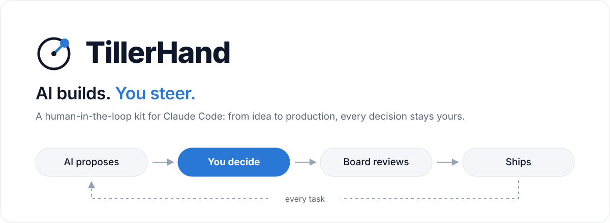
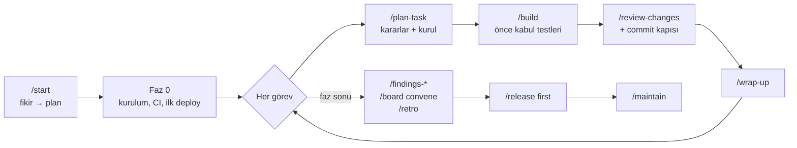

<p align="center">
  <picture>
    <source media="(prefers-color-scheme: dark)" srcset="kit/assets/banner-dark.svg">
    
  </picture>
</p>

<p align="center">
  <a href="kit/CHANGELOG.md"></a>
  <a href="LICENSE"></a>
  
  
  
</p>

<p align="center">
  <b>Türkçe</b> · <a href="README.en.md">English</a> · <a href="https://burakdogrul.github.io/TillerHand/kit/guide.html"><b>Rehberi oku →</b></a>
</p>

<p align="center">
  <a href="#hiç-bilmiyorsan-adım-adım">Adım adım</a> ·
  <a href="#hızlı-başlangıç">Hızlı başlangıç</a> ·
  <a href="#nasıl-çalışır">Nasıl çalışır</a> ·
  <a href="#uzman-kurulu">Kurul</a> ·
  <a href="#koruma-katmanları">Korumalar</a> ·
  <a href="#komutlar">Komutlar</a> ·
  <a href="#lisans">Lisans</a>
</p>

---

**TillerHand**, [Claude Code](https://claude.com/claude-code) ile bir ürünü fikirden canlıya ve bakıma kadar götüren bir başlangıç kitidir. Kodu AI yazar, **kararları sen verirsin**: her önemli adımda seçenekleri, hangisinin ne zaman daha iyi olduğunu ve önerisini sunar. Bir **uzman kurulu** işi denetler, **koruma katmanları** tehlikeli işlemleri daha olmadan durdurur, proje her an **düzenli bir klasör yapısında** kalır.

| | |
|---|---|
| **Soru odaklı** | Ürün, teknik, tasarım, veri, güvenlik ve maliyet kararları gerekçeli seçeneklerle sorulur. Tasarım soruları görsel önizlemeyle gelir. |
| **Uzman kurulu** | Ürün, Mimar, Güvenlik, UX, KVKK, QA ve diğer üyeler planı, görevi, commit'i ve fazı denetler. |
| **Önce test** | Kabul testleri koddan önce yazılır ve önce kırmızı olur. "Bitti" demeden çalıştığı gösterilir. |
| **Bulgu raporları** | Teknik, iş, güvenlik, UX, performans ve hukuk için en önemli 20 bulgu; puanlı, düzeltme yöntemiyle. |
| **Koruma katmanları** | Sır, yıkıcı komut, onaysız prod deploy, zayıflatılan test ve harita dışı dosya daha olmadan durdurulur. |
| **Kontrol paneli** | `dashboard.html`: durum, dikkat gerektirenler, kararlar, kurul, bulgular, kalite, operasyon, limit. |
| **Limit farkındalığı** | 5 saatlik ve haftalık limit okunur, iş buna göre planlanır. Uyarı verir, işi durdurmaz. |
| **Doğru kaynak** | Değişebilen bilgi (sürüm, fiyat, mevzuat) birincil kaynaktan, kaynak ve tarihle doğrulanır. |
| **Geri alma** | `/rollback` son çalışan hale döner; geçmiş silinmez, yarım iş saklanır. |
| **Anlatıcı mod** | İstersen her değişikliği yazılım bilmeyen birine anlatır gibi sade Türkçe açıklar. |
| **Seni tanır** | Nasıl çalışmak istediğini (konuşma, soru, rapor, kod tarzı) öğrenir. Onayladığın tercihler tüm projelerinde geçerli olur ve bilgisayarında kalır. |
| **Rol bazlı model** | Planlama, kod, inceleme ve doküman için modeli ve effort'u her görevin başında sen seçersin. Kod, inceleme ve doküman işleri seçtiğin modelde çalışan alt ajanlara gider. |

## Hiç bilmiyorsan: adım adım

Kod yazmayı bilmen gerekmez. Git, terminal ve kurulum işlerini Claude yapar; sen ne istediğini anlatır ve seçim yaparsın.

**1. Hazırlık (bir kez)**
- Hesaplar: [GitHub](https://github.com) (ücretsiz) ve Claude **Pro** veya **Max** aboneliği.
- Programlar: [Claude masaüstü uygulaması](https://claude.com/download), [Node.js](https://nodejs.org) (LTS), [Git](https://git-scm.com/downloads).

**2. Projeni oluştur**
1. Projen için bir klasör aç ve Claude masaüstü uygulamasında **Code** sekmesinde seç.
2. Şunu yaz: `bu klasörde npx tillerhand init komutunu çalıştır`.
3. Aynı klasörde **yeni oturum aç**. Kitin komutları ve korumaları yeni oturumda yüklenir.

**3. Başlat**

```
/start Serbest çalışanlar için fatura ve tahsilat takip uygulaması
```

Claude sırayla soru sorar. **Her sorunun ilk seçeneği önerilendir**; emin değilsen onu seç. Var olan bir projen varsa `/start` yerine `/adopt` yaz: Claude kodu tarar, belgeleri koddan çıkarır ve projeyi adım adım kitin düzenine getirir.

**4. Her gün**

| Ne zaman | Ne yazarsın |
|---|---|
| Çalışmaya başlarken | `/build` (sıradaki görevi kendisi alır, test eder) |
| Durumu merak edersen | `ne durumdayız?` veya `/dashboard` |
| Bir şey bozulursa | `/rollback` |
| Bırakırken | `/wrap-up`, sonra `/clear` |

**Bilmen gerekenler**
- **Limit:** Pro'da 5 saatlik ve haftalık limit var. Claude %90, %95 ve %99'da uyarır; limit dolarsa yenilenince `/build` ile kaldığın yerden devam edersin.
- **Onay:** Veritabanı, tasarım, maliyet kararları sorulmadan verilmez. Veri silme, ödeme ve canlıya alma her zaman onay ister.
- **Devir:** Projeyi başkasına bırakacaksan `/handoff`; devralan `/handoff devral` ile aynı yerden devam eder.

## Hızlı başlangıç

**Gereksinimler:** [Claude Code](https://claude.com/claude-code), Git, Node.js 18+

```bash
mkdir yeni-proje && cd yeni-proje
npx tillerhand init
claude
```

npm yerine git ile (kit, proje içinde `vibe-kit/` klasöründe durur ve `.gitignore`'a girer):

```bash
git clone https://github.com/burakdogrul/TillerHand.git vibe-kit
node vibe-kit/kit/kit.mjs init
```

- Açılışta Claude Code, kitin skill eklentilerini kurmayı önerir; kabul et.
- Kit başka bir klasördeyse: `node <kit>/kit/kit.mjs init --project <proje>`.
- Codex veya Antigravity için: `npx tillerhand init --tool codex` (birden fazlası: `--tool claude,codex`).
- Önerilen: kod haritası ([codebase-memory-mcp](https://github.com/DeusData/codebase-memory-mcp)). AI kodu dosya dosya okumak yerine sorgular, token tasarrufu sağlar. `/start` kurmayı sorar.

## Nasıl çalışır



**`/start` sihirbazı** fikri dokuz adımda plana çevirir:

| Adım | Ne olur |
|---|---|
| 0 Hazırlık | Profil, planlama derinliği, pano, limit |
| 1 Fikir | Fikir sorgulanır, PRD yazılır |
| 2 Tip | Web/SaaS, mobil veya backend; AI özelliği var mı |
| 3 Kurulum | Seçilen tip ve klasör haritası yerleşir |
| 4 Teknoloji | Tipin karar kataloğu: veritabanı, kimlik, barındırma… |
| 5 Mimari | Veri modeli, roller, servisler, birim ekonomisi |
| 6 Kurul | Uzman kurulu kurulur (önce maliyeti söylenir) |
| 7 Tasarım | Görsel önizlemelerle stil, renk, yazı tipi |
| 8 Yol haritası | Kabul testi önce gelen, öncelikli görevler |
| 9 Kapanış | Özet ve ilk görev |

**Karar protokolü:** Her karar noktasında 2-4 seçenek gelir; önerilen ilk sıradadır ve her seçeneğin ne zaman daha iyi olduğu ve bedeli yazar. Geri dönüşü zor kararlarda (veritabanı, auth, ödeme, veri modeli) önce kurulun görüşü alınır. Kararlar `docs/decisions/log.md`'ye yazılır ve bir daha sorulmaz.

## Uzman kurulu

Ürün tipine göre projene özel kurul ajanları oluşturulur. Kurul danışmandır; kritik bulgu (RET) varsa iş bitmez, sana sorulur.

| Tip | Önerilen kurul |
|---|---|
| Web / SaaS | Ürün · Mimar · Güvenlik · UX · Performans · KVKK · QA |
| Mobil | Ürün · Mimar · Güvenlik · UX · Mobil Platform · KVKK · QA |
| Backend | Ürün · Mimar · Güvenlik · API · DevOps · QA |

| Toplantı | Ne zaman |
|---|---|
| Plan | `/plan-task` sonunda |
| Görev sonu | `/build` sonunda |
| Commit | Her commit'te (hafif, sadece değişiklik) |
| Faz sonu, canlıya alma | `/board convene`, `/release first` |

Önemli kararlarda **konsey** çalışır: farklı modeller aynı soruyu birbirinden habersiz cevaplar, birbirini anonim sıralar, başkan sonucu yazar. Sayımı kod yapar; son karar yine senindir.

## Bulgu raporları

Projeyi bir uzman gözüyle tarar, en önemli **20 bulguyu** kanıt, puan (0-100) ve düzeltme yöntemiyle `docs/findings/` altına yazar. Her rapor bir öncekiyle karşılaştırılır ve panoda eğilim olarak görünür.

| Komut | Bakış açısı | Örnek bulgu |
|---|---|---|
| `/findings-tech` | Kıdemli mimar | N+1 sorgu, tekrar eden yetki kontrolü |
| `/findings-business` | Sektörün uzmanı | Eksik iade kuralı, rakiplerin standart özelliği |
| `/findings-security` | Saldırgan | IDOR, istemciye sızan anahtar |
| `/findings-ux` | UX araştırmacısı | Boş durum yok, yetersiz kontrast |
| `/findings-perf` | Performans ve FinOps | Büyük paket, sınırsız AI maliyeti |
| `/findings-legal` | Uyum uzmanı | Eksik rıza, envanterde olmayan kişisel veri |
| `/findings-all` | Hepsi, paralel | Birleşik özet ve ortak düzeltme planı |

## Proje yapısı

Her proje bu düzende başlar ve bu düzende kalır. Kod özellik bazlıdır: bir özelliğe ait her şey `features/<özellik>/` altında durur.

```
.
├── .claude/          # komutlar, ajanlar, hook'lar, kurul, klasör haritası
├── .github/          # CI, Dependabot
├── docs/
│   ├── product/      # PRD, yol haritası, sözlük, lansman
│   ├── architecture/ # genel bakış, stack, yapı
│   ├── decisions/    # karar günlüğü ve ADR'ler
│   ├── quality/      # test planı, metrikler, retro
│   ├── security/     # güvenlik kontrol listesi
│   ├── operations/   # canlıya alma, dağıtım, bakım, hesaplar
│   └── findings/     # bulgu raporları
├── src/ veya app/    # özellik bazlı kod
├── tests/
└── AGENTS.md · CLAUDE.md · README.md · CHANGELOG.md
```

Harita dışı yeni dosya sorulur, `*.bak` ve `*-old.*` gibi dağınıklık dosyaları engellenir; CI her PR'da yapıyı denetler.

## Koruma katmanları

| Katman | Ne yapar |
|---|---|
| Sır engeli | Koda veya dokümana yazılan API anahtarını engeller |
| Yıkıcı komut kalkanı | `DROP`, koşulsuz `DELETE`, `db reset` engellenir; prod deploy ve geri alma sorulur |
| Paket kapısı | Var olmayan paketi engeller (kurulumda ve `npx`, `uvx` ile çalıştırmada); çok yeni veya popüler bir pakete benzeyeni sorar |
| Yapı koruyucu | Harita dışı dosyayı sorar, dağınıklık dosyalarını engeller |
| Test koruması | Silinen, atlanan veya gevşetilen testi sorar |
| Deterministik kapı | Lint, tip, test ve Semgrep çalışmadan commit açılmaz; koda yazılmış makineye özel yolu yakalar |
| Commit kapısı | Kurul denetimi ve yeşil kapı olmadan commit atılmaz |
| Düzenleme kilidi | `/freeze <klasör>` açıkken AI sadece o klasöre yazar |
| Kapsam kalkanı | Onaylı planın dışındaki dosyaya yazım sorulur |
| Yapılandırma onayı | Kural ve koruma dosyaları onayın olmadan değişmez |
| Dev/prod ayrımı | AI ve yerel ortam sadece dev veritabanına bağlanır |

## Komutlar

| Komut | Ne yapar |
|---|---|
| `/start [fikir]` | Dokuz adımlı başlangıç sihirbazı |
| `/adopt` | Var olan projeyi kite alır, uyum yol haritası çıkarır |
| `/plan-task [görev]` | Kararları sorar, kurul görüşüyle plan çıkarır |
| `/build [görev]` | Önce kabul testleri, sonra kod, kanıt ve kurul denetimi |
| `/design` | Görsel önizlemeli tasarım kararları |
| `/review-changes` | Bağımsız inceleme ve güvenlik ajanları |
| `/fix-bug [belirti]` | Kök neden, kırmızı test, düzeltme |
| `/qa` | Arayüz kriterlerini gerçek tarayıcıda test eder |
| `/findings-<tür>` | Bulgu raporları |
| `/board` | Kurulu kurar, toplar; `council <soru>` ile konsey |
| `/dashboard` | Kontrol paneli |
| `/rollback` | Son çalışan hale döner |
| `/freeze <klasör>` | Düzenlemeyi tek klasöre kilitler |
| `/wrap-up` | Oturumu kapatır, ilerlemeyi kaydeder |
| `/release [first]` | Canlıya alma kontrolleri; `first` hosting, alan adı, yedek ve geri almayı adım adım kurdurur |
| `/maintain` | Haftalık, aylık, çeyreklik bakım |
| `/retro` | Dersleri projeye ve kite geri yazar |
| `/handoff` | Projeyi başkasına devreder veya devralır |
| `/kit-update` | Projeyi kitin son sürümüne günceller |

Tüm komutlar, ayarlar, araçlar ve skill'ler **[rehberde](https://burakdogrul.github.io/TillerHand/kit/guide.html)**.

## Codex ve Antigravity

Kit Claude Code için yazıldı; kurallar, komutlar ve korumalar OpenAI Codex ve Google Antigravity'de de çalışır. Kurul tek modelle yürür; soru arayüzü, durum çubuğu ve commit kapısı bu araçlarda yok. Kurulum: `node <kit>/kit/kit.mjs init --tool codex` (veya `antigravity`).

## Ölçüm

Aynı görevler kitli ve kitsiz `claude -p` ile koşuldu, gizli testlerle puanlandı (3.18.2, Sonnet, 6 görev, koşul başına 24 koşu):

- İki koşul da gizli testlerin hepsini geçti.
- Kitin yazdığı testler, koda bilerek eklenen hataların **%63**'ünü yakaladı; kitsiz koşunun testleri **%31**'ini.
- Kit her koşuda testi koddan önce yazdı; kitsiz koşu hiçbirinde yazmadı.

## Lisans

[MIT](LICENSE) © 2026 Burak Doğrul
