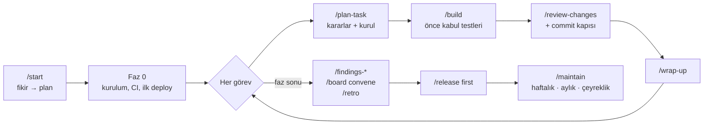
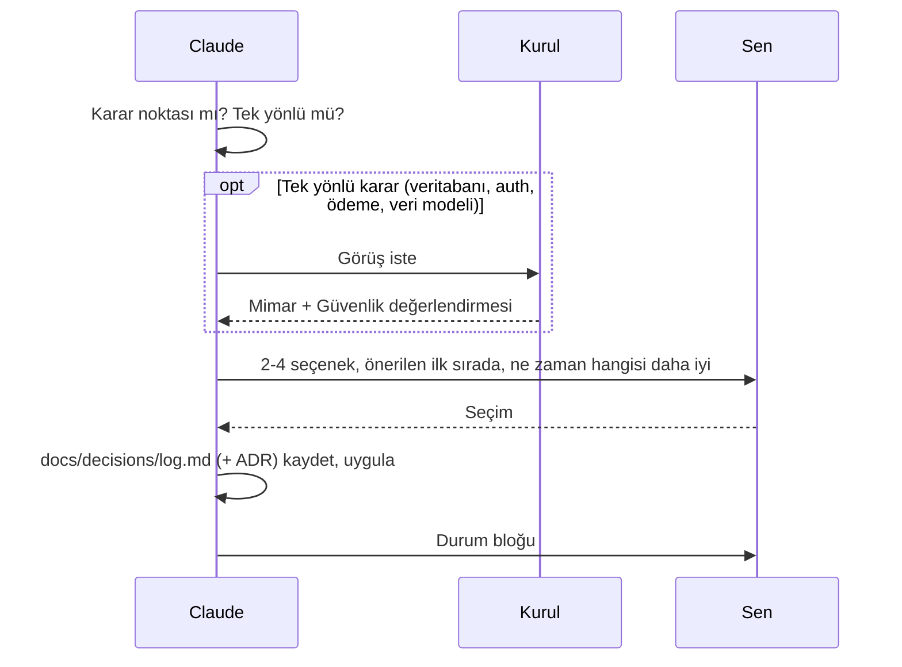
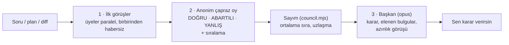
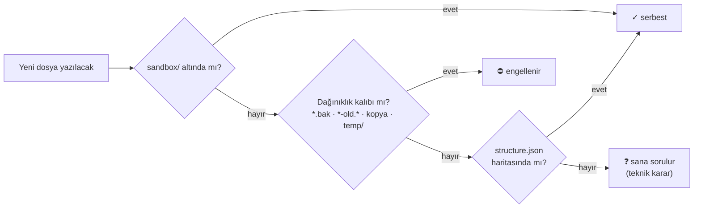
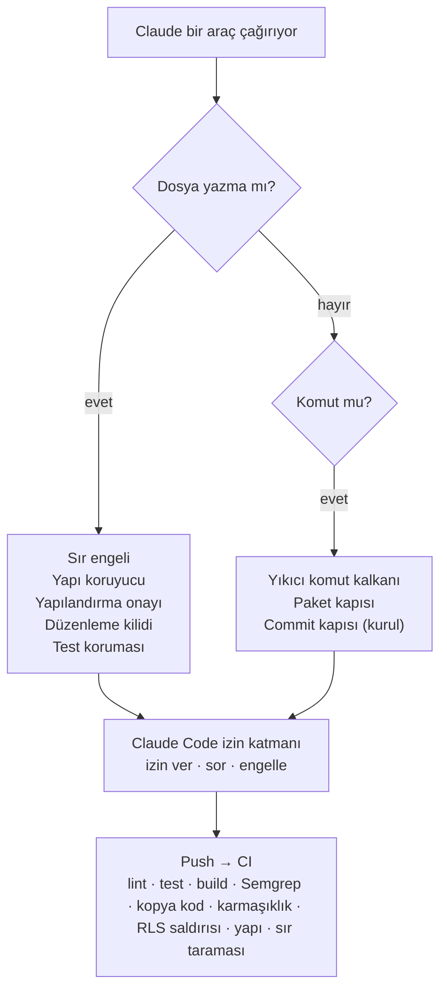

<p align="center">
  
</p>

<p align="center">
  
  
  
  
  
  
</p>

<p align="center">
  <a href="#-hiç-bilmiyorsan-adım-adım">Hiç bilmiyorsan</a> ·
  <a href="#-hızlı-başlangıç">Hızlı başlangıç</a> ·
  <a href="#-nasıl-çalışır">Nasıl çalışır</a> ·
  <a href="#-bulgu-raporları">Bulgular</a> ·
  <a href="#-proje-yapısı">Yapı</a> ·
  <a href="#-komutlar">Komutlar</a> ·
  <a href="#-codex-ve-antigravity">Codex ve Antigravity</a> ·
  <a href="#-kiti-geliştirmek">Geliştirme</a>
</p>

---

**Vibe Coding Kit**, Claude Code ile bir ürünü fikirden canlıya ve bakıma kadar götüren bir GitHub template reposudur. AI kod yazar, ama **kararları sen verirsin**: her adımda seçenekleri, hangisinin ne zaman daha iyi olduğunu ve önerisini sunar. Projeye özel bir **uzman kurulu** her işi denetler, **koruma katmanları** tehlikeli işlemleri engeller, **bulgu raporları** projeyi 100 üzerinden puanlar ve proje her an **profesyonel bir klasör yapısında** kalır.

| | |
|---|---|
| 🧭 **Soru odaklı** | Teknik, ürün, tasarım, veri, güvenlik ve maliyet kararları gerekçeli seçeneklerle sorulur. Tasarım kararları görsel önizlemeyle sorulur. |
| 🏛️ **Uzman kurulu** | Ürün, Mimar, Güvenlik, UX, KVKK, QA ve diğer üyeler planı, görevi, her commit'i ve fazı denetler. |
| 🔎 **Bulgu raporları** | `/findings-tech`, `-business`, `-security`, `-ux`, `-perf`, `-legal`: En önemli 20 bulgu, puanlı ve düzeltme yöntemli. |
| 🗂️ **Korunan yapı** | Özellik bazlı klasör haritası; harita dışı yazım sorulur, dağınıklık engellenir, CI denetler. |
| 🛡️ **Koruma katmanları** | Sır engeli, paket kapısı, yıkıcı komut kalkanı, yapılandırma onayı, düzenleme kilidi, test koruması, düzenleme turu sayacı, commit kapısı, yazarken güvenlik incelemesi. |
| 📊 **Kontrol paneli** | `dashboard.html`: durum, dikkat gerektirenler, kararlar, kurul, bulgular, kalite, operasyon, limit. |
| ⏱️ **Limit farkındalığı** | 5 saatlik ve haftalık limit okunur; işler limite göre planlanır. Limit sadece uyarı verir (%90, %95, %99), işi durdurmaz. |
| 🌐 **Doğru kaynak** | Değişebilen bilgi birincil kaynaktan doğrulanır (kaynak ve tarihle); kütüphane dokümanı Context7'den güncel gelir. |
| 🎨 **Logo ve video** | SVG logo ve marka paketi; kod ile üretilen, 120 BPM ritimli tanıtım videosu. |
| ↩️ **Geri alma** | `/rollback`: Son çalışan hale güvenle döner. Geçmiş silinmez, yarım iş saklanır. |
| 🗣️ **Anlatıcı mod** | Her değişikliği ve hatayı yazılım bilmeyen birine anlatır gibi sade Türkçe açıklar. |
| 💸 **Harcama alarmı** | Canlıdaki ürünün ücretli servislerine tavan ve uyarı; uygulama içinde kullanıcı kotası ve günlük bütçe. |
| 🔔 **Bildirim** | Claude soru sorduğunda veya uzun işi bitirdiğinde masaüstü bildirimi. |
| 🪶 **Az token** | Açılışta yaklaşık 1.900 token; dokümanlar gerektiğinde okunur; kod haritası desteği. |

## 🐣 Hiç bilmiyorsan: adım adım

Kod yazmayı bilmen gerekmez. Teknik işleri (git, terminal komutları, kurulumlar) Claude yapar ve önemli her adımda sana sorar. Sen ne istediğini anlatır ve seçim yaparsın.

**1. Hesaplar (bir kez)**
- [GitHub](https://github.com) hesabı (ücretsiz). Projen burada saklanır.
- Claude **Pro** veya **Max** aboneliği.

**2. Programlar (bir kez)**
- [Claude masaüstü uygulaması](https://claude.com/download). Projeyi içindeki **Code** sekmesinde açacaksın.
- [Node.js](https://nodejs.org): "LTS" yazan sürümü indir, varsayılan ayarlarla kur.
- [Git](https://git-scm.com/downloads): Windows'ta "Git for Windows"u varsayılan ayarlarla kur.
- [GitHub Desktop](https://desktop.github.com) (isteğe bağlı): Projeyi bilgisayarına almanın en kolay yolu.

**3. Kendi projeni oluştur**

Kit ve projen ayrı klasörlerde durur. Kit dosyaları uygulamanın arasına karışmaz, projenin git geçmişi de sadece kendisine ait olur.

1. Projen için bir klasör aç (örn. `Belgeler/fatura-takip`).
2. Claude masaüstü uygulamasında **Code** sekmesine geç ve bu klasörü seç.
3. Şunu yaz: `github.com/burakdogrul/vibecoding reposunu bu klasörün içine vibe-kit adıyla klonla, sonra node vibe-kit/kit/kit.mjs init komutunu çalıştır`.
   - Kit, ihtiyaç duyulan dosyaları (`.claude/`, `CLAUDE.md`, `docs/`) proje klasörüne kopyalar, git deposu açar ve `vibe-kit/` klasörünü `.gitignore`'a ekler. Kit klasörüne dokunulmaz.
   - Kiti tek bir yerde de tutabilirsin (örn. `Belgeler/vibe-kit`). O zaman her yeni projede `node ../vibe-kit/kit/kit.mjs init` yeterli.
4. **Yeni oturum aç** (sol üstte yeni oturum, aynı klasör). Kitin komutları ve korumaları yeni oturumda yüklenir.

<details>
<summary>Eski yol: GitHub "Use this template"</summary>

Kitin GitHub sayfasında **Use this template → Create a new repository** ile yeni repo aç, bilgisayarına klonla ve klasörü Claude'da aç. Kit dosyaları projeyle aynı repoda başlar; `/start` kurulumda `kit/` klasörünü siler.
</details>

**Var olan bir projen mi var?** Aynı şekilde kur, sonra `/start` yerine `/adopt` yaz. Claude kodu tarar, belgeleri koddan çıkarır, neyi beğenmediğini sorar ve projeyi adım adım kitin düzenine getiren bir yol haritası hazırlar. Önce kritik akışlara test yazılır, dosyalar sonra taşınır. Projendeki dosyaların üzerine yazılmaz: kitin hali yanına `.kit-new` olarak konur ve her biri sana sorulur.

**4. Başlat**
1. Eklentileri kurmayı önerirse kabul et.
3. Fikrini yaz:
   ```
   /start Serbest çalışanlar için fatura ve tahsilat takip uygulaması
   ```
4. Claude sırayla soru sorar. **Her sorunun ilk seçeneği önerilendir**; emin değilsen onu seç. İlk sorular için öneri:
   - **Profil:** Pro aboneliğin varsa **Hafif**.
   - **Planlama derinliği:** Fikrin netse **Hızlı** (5 saatlik limitin yaklaşık %25-35'i). **Ayrıntılı** seçersen tüm adımlar tam yapılır ama Pro'da bir pencerenin tamamı gidebilir. Kurul ve tasarım gibi pahalı adımlardan önce maliyet söylenir; istersen sonraya bırakırsın.
   - **Pano:** **Evet**. `dashboard.html` tarayıcıda açılır; kararları ve adım ilerlemesini baştan canlı izlersin.
   - **Anlatıcı mod:** **Evet**. Claude her değişikliği ve hatayı sade Türkçe anlatır.

**5. Her gün**

| Ne zaman | Ne yazarsın |
|---|---|
| Çalışmaya başlarken | `/build` (görev kodu yazmana gerek yok; sıradaki görevi kendisi alır, test eder) |
| Durum merak edersen | `ne durumdayız?` veya `/dashboard` |
| Bir şey bozulursa | `/rollback` (son çalışan hale güvenle döner) |
| Bırakırken | `/wrap-up` (her şeyi kaydeder), sonra `/clear`. Temiz ekranın üstünde sıradaki komut yazar: `Sıradaki: /build G-004 · ...` |

**Bilmen gereken üç şey**
- **Limit:** Pro'da 5 saatlik ve haftalık kullanım limiti vardır. Claude %90, %95 ve %99'da uyarır ama işi durdurmaz; sen "dur" dersen güvenli şekilde durur. Limit dolup iş kesilirse, yenilenince `/build` ile kaldığın yerden devam edersin.
- **Devir:** Projeyi bir ekip arkadaşına veya başka bir hesaba bırakacaksan `/handoff` yaz. Devralan kişi repoyu açıp `/handoff devral` yazar ve aynı yerden devam eder.
- **Kararlar sende:** Claude veritabanı, tasarım, maliyet gibi kararları sormadan vermez. Ödeme, veri silme ve canlıya alma gibi geri dönüşü zor işlerden önce mutlaka onay ister.
- **Canlıya çıkınca:** Ürünün ücretli servislerine harcama tavanı koy (`docs/operations/spend-alarms.md`). `/release` bunu kontrol eder.

## 🚀 Hızlı başlangıç

**Gereksinimler:** [Claude Code](https://claude.com/claude-code), Git, Node.js 18+

1. Kiti proje klasörüne kur:

```bash
mkdir yeni-proje && cd yeni-proje
git clone https://github.com/burakdogrul/vibecoding.git vibe-kit
node vibe-kit/kit/kit.mjs init
claude
```

2. Proje açılınca Claude Code, tanımlı skill plugin'lerini kurmayı önerir. Kabul et.
3. Başlat. Yeni projede:

```
/start Serbest çalışanlar için fatura ve tahsilat takip uygulaması
```

Var olan projede: `/adopt`. Kit başka bir yerde duruyorsa: `node <kit>/kit/kit.mjs init --project <proje>`. Eski yol olan **Use this template** de çalışmaya devam ediyor.

`init` hangi araçla çalışacağını sorar. Codex veya Antigravity kullanıyorsan doğrudan seçebilirsin: `node vibe-kit/kit/kit.mjs init --tool codex` (birden fazlası: `--tool claude,codex`). Ayrıntı: [Codex ve Antigravity](#-codex-ve-antigravity).

<details>
<summary><b>Skill plugin'lerini kurmak</b></summary>

Proje ayarı eklentileri açar ama indirmez. `/start` onayınla hepsini proje kapsamında kurar (`node .claude/hooks/plugins-sync.mjs --kur`); ardından `/reload-plugins`. Elle kurmak istersen:

```
/plugin marketplace add juliusbrussee/caveman
/plugin marketplace add pbakaus/impeccable
/plugin marketplace add Leonxlnx/taste-skill
/plugin marketplace add nextlevelbuilder/ui-ux-pro-max-skill
/plugin marketplace add blader/humanizer
/plugin marketplace add DietrichGebert/ponytail
/plugin marketplace add mattpocock/skills
/plugin install caveman@caveman
/plugin install impeccable@impeccable
/plugin install taste-skill@taste-skill
/plugin install ui-ux-pro-max@ui-ux-pro-max-skill
/plugin install humanizer@humanizer
/plugin install ponytail@ponytail
/plugin install mattpocock-skills@mattpocock
```
</details>

<details>
<summary><b>Önerilen: kod haritası (codebase-memory-mcp)</b></summary>

AI kodu dosya dosya okumak yerine sorgular; proje büyüdükçe ciddi token tasarrufu sağlar. `/start` kurmak isteyip istemediğini sorar. Kurulumu kendi terminalinde yaparsın ([kaynak](https://github.com/DeusData/codebase-memory-mcp)):

```powershell
# Windows (PowerShell)
Invoke-WebRequest -Uri https://raw.githubusercontent.com/DeusData/codebase-memory-mcp/main/install.ps1 -OutFile install.ps1
Unblock-File .\install.ps1
.\install.ps1
```

```bash
# macOS / Linux
curl -fsSL https://raw.githubusercontent.com/DeusData/codebase-memory-mcp/main/install.sh | bash
```
</details>

## 🧭 Nasıl çalışır



### `/start` sihirbazı

| Adım | Ne olur | Örnek soru |
|---|---|---|
| 0 Hazırlık | Profil, planlama derinliği, pano, ortam, skill, limit, kod haritası | "Planlama derinliği: Hızlı (~%25-35) / Standart / Ayrıntılı?" |
| 1 Fikir | Fikir sorgulanır → PRD | "İlk sürümde hangi özellikler olsun?" (çoklu seçim) |
| 2 Tip | Web/SaaS, mobil veya backend; AI özelliği var mı | "Kullanıcın masa başında çalışıyor; web öneriyorum. Uygun mu?" |
| 3 Kurulum | Seçilen tip ve yapı haritası yerleşir, `kit/` silinir | - |
| 4 Teknoloji | Tipin karar kataloğu (10-12 karar) | "Veritabanı: Supabase / Neon + Better Auth / Firebase?" |
| 5 Mimari | Veri modeli, roller, servisler, hesaplar, birim ekonomisi | "Silinen fatura çöp kutusuna mı gitsin?" |
| 6 Kurul | Uzman kurulu ve model dağılımı (pahalı adım: önce maliyet sorulur) | "Kurul kurulumu ~%5-10. Yap / Hafif yap / Sonraya bırak?" |
| 7 Tasarım | Görsel önizlemelerle stil, renk, yazı tipi (pahalı adım) | "Bu üç açılış sayfasından hangisi?" |
| 8 Yol haritası | Kabul testi önce gelen görevler, öncelik | "Faz 1'de hangi özellikle başlayalım?" |
| 9 Kapanış | Özet, ilk görev | - |

Kararlar verildiği anda günlüğe yazılır; pano Adım 0'dan itibaren onları ve adım ilerlemesini gösterir. Stack seçilince README'nin Gereksinimler/Kurulum bölümü ve sürüm dosyası (`.nvmrc` / `.python-version`) doldurulur; proje başka bilgisayarda aynı şekilde kurulabilir. `/release` ve aylık `/maintain` bunu temiz bir klasörde kurarak sınar.

### Karar protokolü



"Tasarımda sorma" dersen sadece o konu kapanır ve o konudaki kararlar "otomatik" olarak kaydedilir; `/ask-mode on` ile tekrar açılır. Veri silme, prod deploy ve para harcatan işlemler her zaman onay ister.

## 🏛️ Uzman kurulu

Seçilen ürün tipine göre senin projende özelleştirilmiş ajanlar (`.claude/agents/board-*.md`) oluşturulur. Kurul danışmandır; kritik bulguda (RET) iş bitmez ve sana sorulur.

| Tip | Önerilen kurul |
|---|---|
| Web / SaaS | Ürün · Mimar · Güvenlik · UX · Performans · KVKK · QA (+ DevOps, AI) |
| Mobil | Ürün · Mimar · Güvenlik · UX · Mobil Platform · KVKK · QA (+ DevOps, AI) |
| Backend | Ürün · Mimar · Güvenlik · API · DevOps · QA (+ KVKK, AI) |

| Toplantı | Ne zaman | Kim | Model |
|---|---|---|---|
| Plan | `/plan-task` sonunda | Ürün + Mimar + ilgililer | üyenin modeli |
| Görev sonu | `/build` sonunda | ilgili en fazla 3 üye | üyenin modeli |
| Commit | Her commit (hook zorunlu kılar) | ilgili en fazla 2 üye, sadece diff | haiku |
| Faz sonu, canlıya alma | `/board convene`, `/release first` | tüm kurul | üyenin modeli |

### Konsey (üç aşama)

Karpathy'nin [llm-council](https://github.com/karpathy/llm-council) yapısı kurula uyarlandı. Hangi toplantı ve kararların üç aşamadan geçeceğini `/start`'ta seçilen **profil** belirler:

| | **Hafif** (Pro için önerilen) | **Standart** | **Tam** |
|---|---|---|---|
| Eklentiler | Çekirdek: ponytail, caveman, mattpocock-skills, impeccable, humanizer, security-guidance (+ tipin LSP ve stack skill'leri). Diğerleri proje kapsamında kapatılır | Hepsi açık | Hepsi açık |
| Commit denetimi (her commit'te haiku kurul) | Kapalı | Açık | Açık |
| Toplantı konseyi (3 aşama) | Yok; toplantılar tek aşamalı | Faz sonu, canlıya alma | Plan, faz sonu, canlıya alma, RET |
| Karar konseyi | Veritabanı ve auth kararı | Veritabanı ve auth kararı | Tüm tek yönlü kararlar |

Ölçüm (2026-10-12): Bir konsey Pro'da 5 saatlik limitin yaklaşık %12'sini kullandı.



- **Karar konseyi:** 3 danışman (haiku, sonnet, opus) aynı soruyu cevaplar ve birbirini sıralar. Sana sorulan sorudaki "(Önerilen)" seçenek konseyden gelir; her seçenekte konsey oyu ve azınlık görüşü yazar. Elle çağırmak için: `/board council <soru>`.
- **Güvenceler:**
  - Sayımı kod yapar, model sayıyı değiştiremez.
  - Başkan tartışmalı bir kritik bulguyu kendi başına eleyemez, sana sorar.
- **Nerede görünür:** Tutanaklar `docs/workflow/council/` klasörüne yazılır. Panonun Kurul sekmesinde uzlaşma, toplu sıralama ve karar görünür.

## 🔎 Bulgu raporları

Projeyi bir uzman gözüyle tarar ve en önemli **en fazla 20 bulguyu** kanıtla, puanla ve nasıl düzeltileceğiyle `docs/findings/<tür>/` altına yazar. Her rapor bir öncekiyle karşılaştırılır (yeni / devam / kötüleşti / çözüldü) ve panoda eğilim olarak görünür.

| Komut | Bakış açısı | Örnek bulgular |
|---|---|---|
| `/findings-tech` | Kıdemli mimar | Tekrar eden yetki kontrolü, kullanılmayan export'lar, N+1 sorgu, yapı ihlali |
| `/findings-business` | Sektörün kıdemli uzmanı (örn. bankacılıkta bankacı); web araştırmalı | Mutabakat akışı yok, iade kuralı eksik, rakiplerin standart özelliği yok |
| `/findings-security` | Saldırgan | IDOR, istemciye sızan anahtar, imzasız webhook |
| `/findings-ux` | Kullanıcı ve UX araştırmacısı | Boş durum yok, kontrast yetersiz, klavye ile erişilemiyor |
| `/findings-perf` | Performans ve FinOps | Büyük istemci paketi, önbelleksiz sorgu, AI maliyeti sınırsız |
| `/findings-legal` | Uyum uzmanı (hukuki görüş değildir) | Envanterde olmayan kişisel veri, eksik rıza, lisans uyumsuzluğu |
| `/findings-all` | Seçilenlerin hepsi, paralel | Birleşik özet ve ortak düzeltme planı |

**Puanlama**

| Boyut | Puan |
|---|---|
| Etki | 0-40 |
| Olasılık | 0-25 |
| Yayılım | 0-20 |
| Aciliyet | 0-15 |

- **Bulgu önemi** = dört boyutun toplamı (0-100). Seviyeler: Kritik ≥80 · Yüksek 60-79 · Orta 40-59 · Düşük <40.
- **Alan sağlık puanı** = 100 − ceza. Ceza: Kritik 15 · Yüksek 8 · Orta 4 · Düşük 1.
- **Rapor sonrası:** Düzeltme planı (hızlı kazanımlar / planlı / büyük işler), ilgili kurul üyesinin görüşü ve hangi bulguların yol haritasına gireceği sorusu.

## 🗂️ Proje yapısı

Kurulumdan sonra her proje bu düzende başlar ve **bu düzende kalır**. Kod özellik bazlıdır: bir özelliğe ait her şey `features/<özellik>/` altında durur.

```
.
├── .claude/                 # komutlar, ajanlar, hook'lar, kurul, bulgular, structure.json
├── .github/                 # CI, Dependabot, bulut ajanları
├── docs/
│   ├── product/             # prd · roadmap · glossary · launch · feedback · unit-economics
│   ├── architecture/        # overview · stack · structure
│   ├── design/              # design-guide
│   ├── decisions/           # log.md + adr-NNNN-*.md
│   ├── quality/             # test-plan · metrics · retros
│   ├── security/            # checklist
│   ├── legal/               # privacy-kvkk
│   ├── operations/          # release-checklist · maintenance · accounts · feature-flags
│   ├── workflow/            # progress · decision-protocol · skills · board · usage-limits · cost-log
│   ├── findings/            # /findings-* raporları
│   └── archive/             # artık geçerli olmayan dokümanlar
├── src/  veya  app/         # özellik bazlı kod (tipe göre; docs/architecture/structure.md)
├── tests/
├── sandbox/                 # deneme ve geçici işler (git'e girmez)
└── AGENTS.md · CLAUDE.md · README.md · CHANGELOG.md
```

`AGENTS.md` ortak kuralları tutar (Claude Code, Codex, Antigravity okur); `CLAUDE.md` onu `@AGENTS.md` ile içe alır ve Claude Code'a özel ekleri taşır. Codex veya Antigravity seçildiyse `.agents/skills/` (komutların skill kopyaları) ve aracın hook ayarı (`.codex/hooks.json`, `.agents/hooks.json`) da gelir.



Yapı dört yerde korunur: yazım anında hook, her PR'da CI (`structure` işi), kurul Mimarı ve `/findings-tech`.

## 🛡️ Koruma katmanları



| Katman | Ne yapar |
|---|---|
| Sır engeli | Koda yazılan API anahtarı engellenir |
| Paket kapısı | Paket kayıt defterinden doğrulanır: yoksa engellenir; çok yeni, az indirilmiş veya popüler bir pakete benziyorsa sorulur |
| Yıkıcı komut kalkanı | `DROP`, `TRUNCATE`, koşulsuz `DELETE`, `db reset` ve prod ortam değişkenlerini makineye çekmek (Vercel `env pull`, prod hedefli) engellenir; prod deploy ve uzak veritabanı işlemleri sorulur |
| Yapı koruyucu | Harita dışı yeni dosya sorulur, dağınıklık dosyaları engellenir |
| Yapılandırma onayı | `CLAUDE.md`, `AGENTS.md`, `.claude/`, `.codex/`, `.mcp.json` ve iş akışı dosyaları onayın olmadan değişmez |
| Commit kapısı | Kurul denetimi olmadan commit atılmaz |
| Düzenleme kilidi | `/freeze <klasör>` açıkken AI sadece o klasöre yazabilir |
| Test koruması | Test dosyasında beklenti silinir veya yoruma alınırsa, `.skip`/`.only`/`skipIf` eklenirse, beklenti gevşetilirse (`toBeTruthy`, matcher'sız `expect`) ya da test dosyası silinir veya taşınırsa sorulur. Test ayarında kapsamı daraltan değişiklik (`include`/`exclude`, `passWithNoTests`, test script'i) ve test dosyasına yazan kabuk komutu (`sed -i`, `rm`, `>`) da sorulur |
| Düzenleme turu sayacı | Aynı kod dosyası bir oturumda 5., 10. kez düzenlenince AI'ya Semgrep ve güvenlik incelemesi hatırlatılır |
| Dev/prod ayrımı | Yerel ortam ve AI (salt-okunur MCP dahil) sadece dev projesine bağlanır; prod sırları barındırma panelinde kalır, `/release` kontrol eder |
| CI bütçeleri | Değişen dosyalarda fonksiyon karmaşıklığı 15, fonksiyon 80, dosya 400 satır (lizard); Supabase varsa yerel Supabase'e karşı RLS saldırgan testi |
| Güvenlik incelemesi | `security-guidance` (Anthropic): yazarken riskli kalıp uyarısı, commit'te ayrı modelle inceleme. Tur sonu incelemesi kota için kapalı gelir |

## 📊 Kontrol paneli ve raporlama

- **Durum bloğu:** Her cevabın sonunda aşama, görev, soru modu, limit, kurul ve sıradaki adım.
- **Masaüstü bildirimi:** Claude soru sorduğunda, onay beklediğinde veya 90 saniyeden uzun bir iş bittiğinde. Kapatmak için `KIT_NOTIFY=off`.
- **Durum çubuğu:** Claude Code'un alt çubuğunda `▶ Faz 1 · G-012 · görev 7/23 · soru: açık · 5s %34 · hf %5 · bağlam %42`.
- **`dashboard.html`:**
  - Üstte: Şimdi, Dikkat gerektirenler, özet kutucuklar.
  - 10 sekme: Genel, Yol haritası, Kararlar, Kurul, Bulgular, Kalite, Aktivite, Ürün ve teknik, Operasyon, Limit ve maliyet.
  - Ürün ve teknik sekmesi: PRD, MVP ve kabul testleri, birim ekonomisi, geri bildirim, stack, tasarım, marka paketi, tanıtım videoları, araştırma notları.
  - Her Claude cevabından sonra kendiliğinden güncellenir ve açıkken 30 saniyede bir yenilenir.

## ⌨️ Komutlar

| Komut | Ne yapar |
|---|---|
| `/start [fikir]` | 9 adımlı başlangıç sihirbazı |
| `/adopt` | Var olan projeyi kite alır: tarar, belgeleri koddan çıkarır, AGENTS.md ve CLAUDE.md'yi yeniden yazar, uyum yol haritası çıkarır |
| `/plan-task [görev]` | Karar noktalarını sorar, kurul görüşüyle plan çıkarır |
| `/build [görev]` | Önce kabul testleri, sonra uygulama; kanıt ve kurul denetimi |
| `/design [kapsam]` | Görsel önizlemeli tasarım kararları |
| `/review-changes` | Bağımsız inceleme ve güvenlik ajanları |
| `/fix-bug [belirti]` | Kök neden, kırmızı test, düzeltme |
| `/freeze <klasör> \| off` | Düzenlemeyi tek klasöre kilitler |
| `/rollback [nokta]` | Son çalışan hale (veya seçilen noktaya) güvenle döner |
| `/findings-<tür>` | `tech` · `business` · `security` · `ux` · `perf` · `legal` · `all` |
| `/board [setup\|convene\|council]` | Uzman kurulunu kurar, toplar; `council <soru>` karar konseyi |
| `/ask-mode [on\|off] [konu]` | Soru modunu yönetir |
| `/dashboard` | Ayrıntılı rapor ve kontrol paneli |
| `/wrap-up` | Oturumu kapatır, ilerlemeyi kaydeder |
| `/release [first]` | Canlıya alma kontrolleri |
| `/maintain [weekly\|monthly\|quarterly]` | Düzenli bakım |
| `/user-feedback` | Kullanıcı geri bildirimini yol haritasına işler |
| `/retro` | Dersleri projeye ve kite geri yazar |
| `/research [konu]` | Makaleler, GitHub'daki benzer projeler, rakip ürünler; fark tablosu; seçilen özellikler PRD'ye |
| `/handoff [devral]` | Projeyi başka kişiye/hesaba devreder veya devralır; aynı yerden devam |
| `/tools [ac\|kapat <paket>\|olc]` | Bağlam paketlerini gösterir, açar/kapatır, skill yükünü ölçer |
| `/kit-update` | Projeyi kitin son sürümüne çeker (`--tool codex` ile araç eklenir) |

## 🔀 Codex ve Antigravity

Kit Claude Code için yazıldı. Kurallar, komutlar ve korumalar OpenAI Codex ve Google Antigravity'de de çalışır. Kurul ajanları, soru arayüzü ve durum çubuğu çalışmaz.

| Parça | Claude Code | Codex | Antigravity |
|---|---|---|---|
| Kurallar | `CLAUDE.md` (`@AGENTS.md` içe alır) | `AGENTS.md` | `AGENTS.md` |
| Komutlar | `/start`, `/build`… | Skill: `$start` ya da `/skills` | Skill: `/start` |
| Korumalar (sır, kalkan, yapı, kilit, paket) | `.claude/settings.json` | `.codex/hooks.json` | `.agents/hooks.json` |
| "Sor" kararı (main'e push, harita dışı dosya) | Onay penceresi | Engellenir; AI sana sorar, onaylarsan işlemi sen yaparsın | Onay penceresi |
| İzin listesi: `rm -rf`, `reset --hard`, `push --force`, `.env`; kural ve koruma dosyalarına yazma | `.claude/settings.json` izinleri | Hook: engellenir | Hook: engellenir veya sorulur |
| Oturum başı notu | Var | Var | Var |
| Seçenekli sorular | AskUserQuestion | Numaralı düz metin | `ask_question` |
| Kurul ve konsey ajanları | Ayrı modeller | Tek model, rolleri sırayla üstlenir | Tek model |
| Durum çubuğu, limit, pano yenileme, commit kapısı | Var | Yok | Yok |

- **Kurulum:** `node <kit>/kit/kit.mjs init --tool codex` (ya da `antigravity`, ya da `claude,codex`). Komutların kaynağı tektir (`.claude/commands/`); `.agents/skills/` altındaki kopyaları `init`, `install` ve `update` üretir. Kopyaları düzenleme, kaynağı düzenle.
- **Codex:** Proje hook'ları ancak klasöre güvendiğinde ve `/hooks` ile onayladığında çalışır. Bunu ilk oturumda yap, yoksa korumalar devre dışı kalır. Codex'i proje kökünde başlat; Windows'ta hook betikleri göreli yolla çağrılır.
- **Sınır:** Kabuk komutuyla dosya yazmak (`echo > dosya`, heredoc) yapı koruyucuya ve düzenleme kilidine takılmaz; sır taraması komut metninde yapılır, kural ve koruma dosyalarını değiştiren kabuk komutu sorulur. Claude Code'da da durum aynı, orada her kabuk komutu zaten onaya gelir.
- **Var olan projeye araç eklemek:** `/kit-update --tool claude,codex`.
- **Dayanak:** Araçların resmi hook ve skill dokümanları (2026-10-23). İki araç da hızlı değişiyor; ilk kullanımda bir sır yazma denemesiyle korumaların çalıştığını gör.

## 🧰 Yetenek paketleri

| Yetenek | Nasıl | Not |
|---|---|---|
| **Kaynak araştırması** | `source-research` skill'i: önce resmi doküman, mevzuat ve standart; her iddiaya kaynak, tarih ve güven seviyesi; çelişkiler gösterilir | Yerleşik web arama ile çalışır |
| **Güncel kütüphane dokümanı** | **Context7** MCP | Ücretsiz, her tipte açık |
| **Site tarama** | **Firecrawl** MCP | İsteğe bağlı; API anahtarını kendin ortam değişkenine eklersin, AI görmez |
| **Logo** | `logo-design`: marka soruları, 4-6 SVG konsept görsel önizlemeyle, seçim, iyileştirme, favicon/ikon/PNG paketi ve kullanım kuralları | API gerekmez |
| **Tanıtım videosu** | `motion-video`: tek kesintisiz dönüşüm, gerçek imleç, kapalı formlu yaylar, 120 BPM; `renderAt(t)` + Playwright + ffmpeg ile MP4 | Remotion seçeneği (resmi plugin, varsayılan kapalı) |
| **Uygulama içi hareket** | `ui-motion`: süre belirteçleri, yaylar, hareket azaltma, performans; Motion / Reanimated | Impeccable `animate` ile denetlenir |
| **Kaydırma animasyonu ve 3D** | Resmi `gsap-skills` (cesur yön, `tasarim` paketi); 3D seçilirse three.js skill'leri (temel, performans, React Three Fiber) sabit sürümle kopyalanır. `ui-motion` → 3D kuralları: tembel yükleme, statik yedek, hareket azaltma, mobil GPU, `dispose()` | GSAP ücretsiz, ticari dahil |
| **İlham markası** | `/design`: beğendiğin ürünün DESIGN.md'si (awesome-design-md, 84 marka) tek dosya indirilir, Impeccable ile ilkeleri damıtılır | Marka taklidi yok: logo, ad, birebir palet alınmaz |
| **Rakip özelliği nasıl çalışıyor** | `/research`, `/adopt`: **rea** CLI (sabit sürüm) ile site veya uygulama incelemesi, kanıtıyla | Sadece sahip olduğun veya yetkili olduğun yazılım; önce uyarı ve onay |
| **İnsan için kod haritası** | **Understand-Anything** (`yayin` paketi): `/understand`, görsel pano, tanıtım rehberi. `/adopt`, `/handoff`, `/release first` önerir | İlk çalıştırma bütün kodu okur, pahalı; Türkçe çıktı yok |
| **Kod zekâsı** | `typescript-lsp` (web, mobil), `pyright-lsp` (backend): her düzenlemeden sonra tip hatası, tanıma gitme | Dil sunucusu global kurulur |
| **Stack kuralları** | Vercel `react-best-practices` + `composition-patterns` (web), `react-native-guidelines` + Expo resmi skill'leri (mobil), Supabase `postgres-best-practices`, `web-quality-skills` (Core Web Vitals, erişilebilirlik, SEO) | Proje tipine göre açılır |
| **Mobil test** | **Maestro** MCP (kabul testleri cihazda) + **Expo** MCP (EAS build, TestFlight çökme kayıtları) | Maestro CLI ve Expo hesabı gerekir |
| **Servis bağlantıları** | GitHub, Stripe, Vercel, PostHog, Figma, Firebase, Linear: `docs/workflow/mcp-catalog.md` | Servis seçilince `/start` önerir |
| **Yazarken güvenlik** | `security-guidance`: kalıp uyarısı + commit incelemesi; `/claude-security`: `/findings-security` için çok ajanlı derin tarama | Model incelemeleri kotadan yer |
| **Öğrenen kurallar** | `/hookify` (tekrarlayan düzeltme hook kuralı olur), `claude-md-management` (CLAUDE.md denetimi, oturum dersleri) | `/retro`, `/wrap-up` önerir |
| **Token ve maliyet** | `ccusage` ile proje başına son 30 gün panoda; `/session-report` ile en pahalı istekler | Yerel çalışır |
| **Güvenlik derinliği** | Trail of Bits: differential-review, insecure-defaults, sharp-edges, static-analysis, supply-chain-risk-auditor, agentic-actions-auditor, fp-check | `/findings-security` ve `security-auditor` kullanır |
| **Gerçek tarayıcı ölçümü** | **Playwright CLI** (konsol, ağ, ekran görüntüsü; MCP'den az token) + gerektiğinde **Chrome DevTools** MCP (performans izi) | `/findings-perf`, `/findings-ux`; MCP'ler komut sorunca eklenir |
| **Canlıya alma** | **Vercel CLI**: önizleme deploy'u ve kanıt, sonra onayla prod | `--prod`, `promote`, `rollback` her zaman sorulur |
| **Veritabanı değişikliği** | Supabase CLI migration; MCP prod'da salt-okunur, yazma sadece dev projesinde | Panelden veya MCP'den elle DDL yok |
| **Bildirim** | `notify.mjs`: soru veya onay beklerken ve 90 sn'den uzun iş bitince | Kapatmak: `KIT_NOTIFY=off` |
| **Anlatıcı mod** | `.claude/output-styles/anlatici.md`: Her adımdan sonra "Ne yaptım / Neden / Sen nasıl görürsün / Yeni kavram" bloğu, hatalar sade dille | `/start` sorar; `.claude/settings.local.json` → `outputStyle` |
| **Geri alma** | `checkpoint.mjs`: `/build` ve `/wrap-up` testler yeşilken çalışan nokta kaydeder; `/rollback` geçmişi silmeden döner | `reset --hard` kullanılmaz |
| **Harcama alarmı** | `docs/operations/spend-alarms.md`: sağlayıcı tavanları (Anthropic, OpenAI, Vercel, Supabase, Google Cloud), uygulama içi kota ve bütçe, panoda kart | `/release` ve `/maintain` kontrol eder |
| **Bağlam paketleri** | Çekirdek eklentiler hep açık; tasarım, güvenlik, yayın ve video paketleri kapalı gelir. `/design`, `/findings-security`, `/release` gerektiğinde açmayı sorar; `/tools` durumu gösterir ve ölçer | Skill listesi bağlamın %1'iyle sınırlı: taşınca skill'ler kaçırılır. Açma sadece senin makineni etkiler |

**Bilerek eklenmeyenler:**
- superpowers, gstack, spec-kit, BMAD, GSD, OpenSpec: Kitin soru, plan ve kurul akışının yerine geçerler. Karpathy ilkeleri, "bitti demeden doğrula" ve CEO bakışı gibi fikirler kitin kendi kurallarına işlendi.
- claude-mem: Kitin ilerleme dosyası ve bellek düzeniyle aynı işi yapar.
- Serena: codebase-memory-mcp ile aynı işi yapar.
- frontend-design, ralph-loop: Biri tasarım skill'lerini tekrarlar, diğeri limiti yakar.

## 🧩 Skill'ler

| Alan | Skill |
|---|---|
| Rapor dili | Caveman (sorular ve dokümanlar tam cümle) |
| Fikir, alan modeli, mimari, araştırma, TDD, hata ayıklama | Matt Pocock skills |
| En küçük tam çözüm, kod incelemesi, denetim | Ponytail |
| Stil yönüne göre arayüz (premium, minimal, cesur, brutalist) | Taste Skill |
| Ürün bağlamı, tasarım sistemi, critique, audit, polish | Impeccable |
| Renk, yazı tipi, tasarım belirteçleri, marka | UI UX Pro Max |
| Kullanıcıya görünen metinler | Humanizer |

Tam eşleme: [`docs/workflow/skills.md`](docs/workflow/skills.md)

## 🛠️ Kiti geliştirmek

```
kit/
├── kit.mjs                  # init · install · update (--tool)
├── tools/                   # codex/.codex/hooks.json · antigravity/.agents/hooks.json
├── templates/
│   ├── web-saas/            # stack, design-guide, structure.json, CI, Dependabot, MCP, pre-commit
│   ├── mobile/
│   ├── backend/
│   └── addons/ai/           # docs/ai/guide.md, ai/evals, ai/prompts
├── project/README.md        # projenin README şablonu
├── assets/banner.svg
├── tests/                   # node --test "kit/tests/*.test.mjs"
├── CHANGELOG.md · VERSION · SOURCE · guide.html
```

- **Test:** `node --test "kit/tests/*.test.mjs"` (CI'da `kit-tests` iş akışı çalıştırır).
- **Sürüm çıkarmak:**
  1. `kit/VERSION` dosyasındaki numarayı artır.
  2. `kit/CHANGELOG.md`'de "[Yayınlanmamış]" bölümünü sürüm numarasıyla adlandır.
  3. Rehberi (`kit/guide.html` ve yayımlı hali), panoyu (`.claude/hooks/dashboard.mjs`) ve bu README'yi güncelle. Yeni bir özellik üçünde de görünmeli.
  4. Testleri çalıştır.
  5. Commit at, `git tag vX.Y.Z` ile etiketle ve push et.
- **Ders toplama:** Projelerdeki dersler `/retro` ile bu repoda bir dala gelir ve onayınla birleşir.
- **Projeleri güncelleme:** Projeler yeni sürümü `/kit-update` ile alır. Senin değiştirdiğin dosyalar ezilmez; yeni hali yanına `.kit-new` olarak gelir.
- **Yeni tip eklemek:** `kit/templates/<tip>/` klasörünü aç. İçine şunları koy:
  - `docs/architecture/stack.md` ("Karar noktaları" bölümü dahil)
  - `docs/architecture/structure.md`
  - `.claude/structure.json`
  - `.claude/settings.merge.json`
  - `.claude/hooks/format.mjs`
  - `.gitignore.append`
  - `.env.example`
- **Yeni ek eklemek:** `kit/templates/addons/<ad>/` klasörünü aç. Var olan bir dosyanın sonuna eklenecek içerik için `x.append`, JSON birleştirmek için `x.merge.json` adını kullan.
