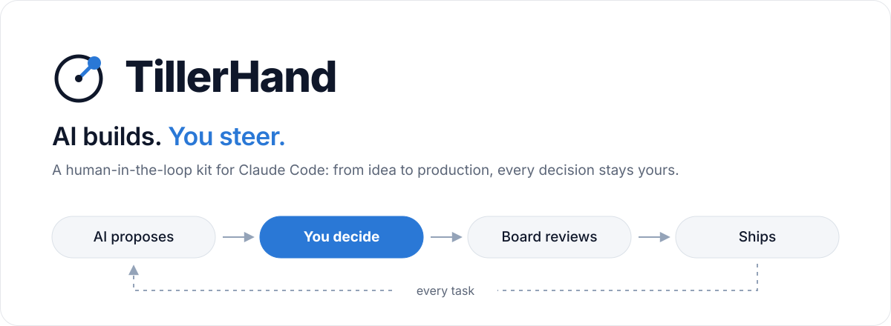
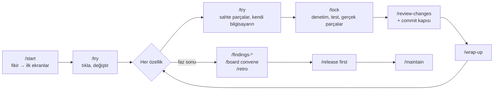

<p align="center">
  <picture>
    <source media="(prefers-color-scheme: dark)" srcset="kit/assets/banner-dark.svg">
    
  </picture>
</p>

<p align="center">
  <a href="kit/CHANGELOG.md"></a>
  <a href="LICENSE"></a>
  
  
  
</p>

<p align="center">
  <a href="README.md">English</a> · <b>Türkçe</b> · <a href="https://burakdogrul.github.io/TillerHand/kit/guide.tr.html"><b>Rehberi oku →</b></a>
</p>

<p align="center">
  <a href="#hiç-bilmiyorsan-adım-adım">Adım adım</a> ·
  <a href="#hızlı-başlangıç">Hızlı başlangıç</a> ·
  <a href="#var-olan-proje-adopt">/adopt</a> ·
  <a href="#nasıl-çalışır">Nasıl çalışır</a> ·
  <a href="#uzman-kurulu">Kurul</a> ·
  <a href="#koruma-katmanları">Korumalar</a> ·
  <a href="#komutlar">Komutlar</a> ·
  <a href="#lisans">Lisans</a>
</p>

---

**TillerHand**, [Claude Code](https://claude.com/claude-code) ile bir ürünü fikirden canlıya ve bakıma kadar götüren bir başlangıç kitidir. Kodu AI yazar, **kararları sen verirsin**: her önemli adımda seçenekleri, hangisinin ne zaman daha iyi olduğunu ve önerisini sunar. Bir **uzman kurulu** işi denetler, **koruma katmanları** tehlikeli işlemleri daha olmadan durdurur, proje her an **düzenli bir klasör yapısında** kalır.

> **Önce dil.** `/start` ve `/adopt` tek bir soruyla açılır: AI seninle hangi dilde konuşsun? Türkçe, İngilizce ya da başka bir dil. Bundan sonra sorular, cevaplar, raporlar, pano ve durum çubuğu o dilde gelir; `/language` ile sonradan değişir. Kitin içindeki her şey (komutlar, kurallar, ajanlar, hook'lar, belge şablonları) İngilizce yazılıdır, Türkiye eki dahil. Türkçe arayüz metinleri `.claude/i18n/tr.json` dosyasıyla gelir; proje dosyalarındaki etiketler ve anahtarlar her dilde İngilizce kalır, çünkü araçlar onları okur.

| | |
|---|---|
| **Soru odaklı** | Ürün, teknik, tasarım, veri, güvenlik ve maliyet kararları gerekçeli seçeneklerle sorulur. Tasarım soruları görsel önizlemeyle gelir. |
| **Senin dilinde** | `/start` ve `/adopt` önce hangi dilde konuşulacağını sorar: Türkçe, İngilizce ya da başka bir dil. Sorular, cevaplar, belgeler, pano ve durum çubuğu o dilde olur; `/language` ile değişir. |
| **Uzman kurulu** | Ürün, Mimar, Güvenlik, UX, KVKK, QA ve diğer üyeler planı, görevi, commit'i ve fazı denetler. |
| **Testi ayrı ajan yazar** | Kabul ve saldırgan testlerini kodu yazan değil, ayrı bir ajan koddan önce yazar ve önce kırmızı olur. Kodu yazan test dosyasına dokunamaz; dolaylı yoldan değişen test commit'e giremez. "Bitti" demeden çalıştığı gösterilir. |
| **Spec ve sapma kontrolü** | Büyük işte ve her hatada mevcut, beklenen ve değişmemesi gereken davranış yazılır; değişmemesi gerekenin testi yoksa kapı kırmızıdır. |
| **Bulgu raporları** | Teknik, iş, güvenlik, UX, performans ve hukuk için en önemli 20 bulgu; puanlı, düzeltme yöntemiyle. |
| **Koruma katmanları** | Sır, yıkıcı komut, onaysız prod deploy, zayıflatılan test ve harita dışı dosya daha olmadan durdurulur. |
| **Canlı önizleme** | Arayüz görevinde dev sunucu açılır, masaüstü ve mobil ekran görüntüsü alınır; `/qa` kabul kriterlerini gerçek tarayıcıda dener. |
| **Canlıya ve sonrasına** | `/release first` hosting, alan adı, yedek ve geri almayı sağlayıcı sağlayıcı kurdurur. Web ve backend projelerinde canlı site 3 saatte bir duman testiyle izlenir. |
| **Türkiye eki** | İsteğe bağlı. iyzico ve PayTR bildirimlerinin imza doğrulaması saldırgan testiyle gelir; KVKK yurt dışı aktarım, e-Fatura/e-Arşiv ve Türkçe İ/ı maddeleri birincil kaynağa bağlıdır. |
| **Kontrol paneli** | `dashboard.html`: durum, dikkat gerektirenler, kararlar, kurul, bulgular, kalite, operasyon, limit; komutlar tek tıkla kopyalanır. |
| **Limit farkındalığı** | 5 saatlik ve haftalık limit okunur, iş buna göre planlanır. Uyarı verir, işi durdurmaz. |
| **Doğru kaynak** | Değişebilen bilgi (sürüm, fiyat, mevzuat) birincil kaynaktan, kaynak ve tarihle doğrulanır. |
| **Geri alma** | `/rollback` son çalışan hale döner; geçmiş silinmez, yarım iş saklanır. |
| **Anlatıcı mod** | İstersen her değişikliği yazılım bilmeyen birine anlatır gibi sade bir dille açıklar. |
| **Seni tanır** | Nasıl çalışmak istediğini (konuşma, soru, rapor, kod tarzı) öğrenir. Onayladığın tercihler tüm projelerinde geçerli olur ve bilgisayarında kalır. |
| **Rol bazlı model** | Planlama, kod, test, inceleme ve doküman için modeli ve effort'u yerel bir panelde (`/models`) seçersin, istersen tek bir iş için de. Panel kullanımını da gösterir; Claude planın ve dış modeller ayrı durur. Komutlar artık durup sormaz; her koşu kullanılan modeli tek satırda gösterir. Testleri ayrı bir ajan yazar; güvenlik, ödeme veya veri silen işlerde kodla aynı kör noktayı paylaşmasın diye Opus önerilir. |
| **Hatadan öğrenir** | Aynı türden hata tekrar edince onu önleyecek tek bir kural önerir; sen onaylarsan eklenir. |

## Hiç bilmiyorsan: adım adım

Kod yazmayı bilmen gerekmez. Git, terminal ve kurulum işlerini Claude yapar; sen ne istediğini anlatır ve seçim yaparsın.

**1. Hazırlık (bir kez)**
- Hesaplar: [GitHub](https://github.com) (ücretsiz) ve Claude **Pro** veya **Max** aboneliği.
- Programlar: [Claude masaüstü uygulaması](https://claude.com/download), [Node.js](https://nodejs.org) (LTS), [Git](https://git-scm.com/downloads).

**2. Projeni oluştur**
1. Projen için bir klasör aç ve Claude masaüstü uygulamasında **Code** sekmesinde seç.
2. Kiti kur. İki yoldan birini seç:
   - Claude'a yaz: `bu klasörde npx tillerhand init komutunu çalıştır`.
   - TillerHand plugin'ini [bir kez kurduysan](#hızlı-başlangıç) Claude'a `/tillerhand:init` yaz.
3. Aynı klasörde **yeni oturum aç**. Kitin komutları ve korumaları yeni oturumda yüklenir.

**3. Başlat**

```
/start Serbest çalışanlar için fatura ve tahsilat takip uygulaması
```

İlk soru dildir: Türkçe, İngilizce ya da başka bir dil. Claude bundan sonra seninle o dilde konuşur ve sırayla soru sorar. **Her sorunun ilk seçeneği önerilendir**; emin değilsen onu seç. Var olan bir projen varsa `/start` yerine `/adopt` yaz: Claude kodu tarar, belgeleri koddan çıkarır ve projeyi adım adım kitin düzenine getirir.

**4. Her gün**

| Ne zaman | Ne yazarsın |
|---|---|
| Bir özelliği denerken | `/try` (kendi bilgisayarında tıkladığın hızlı dilim) |
| Beğenince | `/lock` (kodu denetler, sağlamlaştırır, main'e alır) |
| Küçük değişiklikte | `/tweak` (metin, stil, küçük düzeltme) |
| Diğer işlerde | `/build` (sıradaki görevi kendisi alır, test eder) |
| Durumu merak edersen | `ne durumdayız?` veya `/dashboard` |
| Bir şey bozulursa | `/rollback` |
| Bırakırken | `/wrap-up`, sonra `/clear` |

**Bilmen gerekenler**
- **Limit:** Pro'da 5 saatlik ve haftalık limit var. Claude %90, %95 ve %99'da uyarır; limit dolarsa yenilenince `/build` ile kaldığın yerden devam edersin.
- **Onay:** Veritabanı, tasarım, maliyet kararları sorulmadan verilmez. Veri silme, ödeme ve canlıya alma her zaman onay ister.
- **Devir:** Projeyi başkasına bırakacaksan `/handoff`; devralan `/handoff take` ile aynı yerden devam eder.

## Hızlı başlangıç

**Gereksinimler:** [Claude Code](https://claude.com/claude-code), Git, Node.js 18+

Üç kurulum yolu var. Üçü de kiti projeye aynı şekilde kurar; birini seç.

**1. npm (önerilen):** terminalde en kısa yol.

```bash
mkdir yeni-proje && cd yeni-proje
npx tillerhand init
claude
```

**2. Claude Code plugin:** bilgisayara bir kez kurulur, sonra her yeni projede tek komut. Plugin yalnız kurulumu yapar; kit yine projeye dosya olarak kopyalanır ve her seferinde son sürüm gelir.

Bir kez, Claude Code'da (masaüstü uygulamasında `/plugin` açılmazsa terminalde `claude plugin marketplace add …` ve `claude plugin install …` olarak):

```text
/plugin marketplace add burakdogrul/TillerHand
/plugin install tillerhand@tillerhand
```

Her yeni projede, proje klasöründe açılan oturumda:

```text
/tillerhand:init
```

**3. git:** kitin kaynağını görmek, değiştirmek ya da katkı vermek için. Kit proje içinde `vibe-kit/` klasöründe durur ve `.gitignore`'a girer.

```bash
git clone https://github.com/burakdogrul/TillerHand.git vibe-kit
node vibe-kit/kit/kit.mjs init
```

- Açılışta Claude Code, kitin skill eklentilerini kurmayı önerir; kabul et.
- Kit başka bir klasördeyse: `node <kit>/kit/kit.mjs init --project <proje>`.
- Codex veya Antigravity için: `npx tillerhand init --tool codex` (birden fazlası: `--tool claude,codex`).
- Önerilen: kod haritası ([codebase-memory-mcp](https://github.com/DeusData/codebase-memory-mcp)). AI kodu dosya dosya okumak yerine sorgular, token tasarrufu sağlar. `/start` kurmayı sorar.

## Var olan proje: /adopt

Kodun zaten varsa kurulum aynı, başlangıç komutu farklı. Projenin kökünde `npx tillerhand init` çalıştır (dosyaların ezilmez; çakışan kit dosyası `.kit-new` olarak yanına konur), yeni oturum aç ve `/adopt` yaz.

1. **Tarar:** stack, klasör yapısı, testlerin durumu ve git geçmişi çıkarılır. Bu oturumda koda dokunulmaz.
2. **Belgeleri koddan çıkarır:** PRD, stack ve mimari taslak olarak yazılır; neyi beğenmediğin sorulur, eski `CLAUDE.md` kuralları tek tek sorulup `AGENTS.md`'ye taşınır.
3. **Kritik akışlara test:** giriş, ödeme gibi akışların doğru davranışı sana sorulur; test kodun bugünkü haline değil, senin cevabına göre yazılır.
4. **Uyum yol haritası:** güvenli zemin, yapıyı ayrı dalda özellik özellik taşıma, bulgular. Sonra her gün `/build`.

## Nasıl çalışır



**`/start` sihirbazı** fikri dokuz adımda plana çevirir. İlk sürümü 4. adımdan sonra tıklarsın, kalanını `/lock` çalıştırır:

| Adım | Ne olur |
|---|---|
| 0 Hazırlık | Profil, planlama derinliği, pano, limit |
| 1 Fikir | Fikir sorgulanır, PRD yazılır |
| 2 Tip | Web/SaaS, mobil veya backend; AI özelliği var mı |
| 3 Kurulum | Seçilen tip ve klasör haritası yerleşir |
| 4 Teknoloji | Tipin karar kataloğu: veritabanı, kimlik, barındırma… |
| 5 Mimari | Veri modeli, roller, servisler, birim ekonomisi |
| 6 Kurul | Uzman kurulu kurulur (önce maliyeti söylenir) |
| 7 Tasarım | Görsel önizlemelerle stil, renk, yazı tipi |
| 8 Yol haritası | Kabul testi önce gelen, öncelikli görevler |
| 9 Kapanış | Özet ve ilk görev |

**Karar protokolü:** Her karar noktasında 2-4 seçenek gelir; önerilen ilk sıradadır ve her seçeneğin ne zaman daha iyi olduğu ve bedeli yazar. Geri dönüşü zor kararlarda (veritabanı, auth, ödeme, veri modeli) önce kurulun görüşü alınır. Kararlar `docs/decisions/log.md`'ye yazılır ve bir daha sorulmaz.

## Uzman kurulu

Ürün tipine göre projene özel kurul ajanları oluşturulur. Kurul danışmandır; kritik bulgu (REJECT) varsa iş bitmez, sana sorulur.

| Tip | Önerilen kurul |
|---|---|
| Web / SaaS | Ürün · Mimar · Güvenlik · UX · Performans · KVKK · QA |
| Mobil | Ürün · Mimar · Güvenlik · UX · Mobil Platform · KVKK · QA |
| Backend | Ürün · Mimar · Güvenlik · API · DevOps · QA |

| Toplantı | Ne zaman |
|---|---|
| Plan | `/plan-task` sonunda |
| Görev sonu | `/build` sonunda |
| Commit | Her commit'te (hafif, sadece değişiklik) |
| Faz sonu, canlıya alma | `/board convene`, `/release first` |

Önemli kararlarda **konsey** çalışır: farklı modeller aynı soruyu birbirinden habersiz cevaplar, birbirini anonim sıralar, başkan sonucu yazar. Sayımı kod yapar; son karar yine senindir.

## Bulgu raporları

Projeyi bir uzman gözüyle tarar, en önemli **20 bulguyu** kanıt, puan (0-100) ve düzeltme yöntemiyle `docs/findings/` altına yazar. Her rapor bir öncekiyle karşılaştırılır ve panoda eğilim olarak görünür.

| Komut | Bakış açısı | Örnek bulgu |
|---|---|---|
| `/findings-tech` | Kıdemli mimar | N+1 sorgu, tekrar eden yetki kontrolü |
| `/findings-business` | Sektörün uzmanı | Eksik iade kuralı, rakiplerin standart özelliği |
| `/findings-security` | Saldırgan | IDOR, istemciye sızan anahtar |
| `/findings-ux` | UX araştırmacısı | Boş durum yok, yetersiz kontrast |
| `/findings-perf` | Performans ve FinOps | Büyük paket, sınırsız AI maliyeti |
| `/findings-legal` | Uyum uzmanı | Eksik rıza, envanterde olmayan kişisel veri |
| `/findings-all` | Hepsi, paralel | Birleşik özet ve ortak düzeltme planı |

## Proje yapısı

Her proje bu düzende başlar ve bu düzende kalır. Kod özellik bazlıdır: bir özelliğe ait her şey `features/<özellik>/` altında durur.

```
.
├── .claude/          # komutlar, ajanlar, hook'lar, kurul, klasör haritası
├── .github/          # CI, Dependabot
├── docs/
│   ├── product/      # PRD, yol haritası, sözlük, lansman
│   ├── architecture/ # genel bakış, stack, yapı
│   ├── decisions/    # karar günlüğü ve ADR'ler
│   ├── quality/      # test planı, metrikler, retro
│   ├── security/     # güvenlik kontrol listesi
│   ├── operations/   # canlıya alma, dağıtım, bakım, hesaplar
│   └── findings/     # bulgu raporları
├── src/ veya app/    # özellik bazlı kod
├── tests/
└── AGENTS.md · CLAUDE.md · README.md · CHANGELOG.md
```

Harita dışı yeni dosya sorulur, `*.bak` ve `*-old.*` gibi dağınıklık dosyaları engellenir; CI her PR'da yapıyı denetler.

## Koruma katmanları

| Katman | Ne yapar |
|---|---|
| Sır engeli | Koda veya dokümana yazılan API anahtarını engeller |
| Yıkıcı komut kalkanı | `DROP`, koşulsuz `DELETE`, `db reset` ve bulut verisini silmek engellenir; prod deploy, geri alma ve yayımlama sorulur; `rm -rf` engellidir, git-ignored bağımlılık ve derleme klasörlerini `clean.mjs` temizler |
| Paket kapısı | Var olmayan paketi engeller (kurulumda, `npx`, `uvx` ile çalıştırmada ve bağımlılık dosyalarında); çok yeni, popüler bir pakete benzeyen ve denetleyemediği kaynakları (git, URL, başka kayıt) sorar |
| Yapı koruyucu | Harita dışı dosyayı sorar, dağınıklık dosyalarını engeller |
| Test ayrımı | Test dosyasına yalnız `test-writer` ajanı yazar; ana oturum ve kod ajanı denerse engellenir |
| Test koruması | Silinen, atlanan veya gevşetilen testi sorar |
| Deterministik kapı | Lint, tip, test ve Semgrep çalışmadan commit açılmaz; koda yazılmış makineye özel yolu yakalar |
| Commit kapısı | Kurul denetimi ve yeşil kapı olmadan commit atılmaz; patch veya betikle değişen test dosyası da durur; elle değiştirdiysen `--accept-tests` kabul eder, denetim yine çalışır; merge, revert gibi commit üreten komutlar sorulur; `/try` turları denetim istemez, `/lock` dilimin tamamını denetler, `main`'i commit olmadan taşımak sorulur |
| PDF koruması | Bütün bir PDF bağlama okunmaz: önce `document-to-markdown` dönüştürür; taranmış sayfa veya grafik `pages` ile okunur |
| Düzenleme kilidi | `/freeze <klasör>` açıkken AI sadece o klasöre yazar |
| Kapsam kalkanı | Onaylı planın dışındaki dosyaya yazım sorulur |
| Yapılandırma onayı | Kural ve koruma dosyaları onayın olmadan değişmez |
| Dev/prod ayrımı | AI ve yerel ortam sadece dev veritabanına bağlanır |

## Komutlar

| Komut | Ne yapar |
|---|---|
| `/start [fikir]` | Dokuz adımlı başlangıç sihirbazı |
| `/adopt` | Var olan projeyi kite alır, uyum yol haritası çıkarır |
| `/plan-task [görev]` | Kararları sorar, kurul görüşüyle plan çıkarır |
| `/try [ne]` | Kendi dalında, sahte parçalarla tıklanacak hızlı dilim |
| `/lock` | Denenen kodu korur: denetim, test, gerçek parçalar, birleştirme |
| `/build [görev]` | Önce kabul testleri, sonra kod, kanıt ve kurul denetimi |
| `/design` | Görsel önizlemeli tasarım kararları |
| `/review-changes` | Bağımsız inceleme ve güvenlik ajanları |
| `/tweak [değişiklik]` | Küçük, riski düşük değişiklik: en çok 2 dosya ve 30 satır, plan ve alt ajan yok, gate yeşil |
| `/fix-bug [belirti]` | Kök neden, kırmızı test, düzeltme |
| `/qa` | Arayüz kriterlerini gerçek tarayıcıda test eder |
| `/findings-<tür>` | Bulgu raporları |
| `/board` | Kurulu kurar, toplar; `council <soru>` ile konsey |
| `/dashboard` | Kontrol paneli |
| `/rollback` | Son çalışan hale döner |
| `/freeze <klasör>` | Düzenlemeyi tek klasöre kilitler |
| `/wrap-up` | Oturumu kapatır, ilerlemeyi kaydeder |
| `/release [first]` | Canlıya alma kontrolleri; `first` hosting, alan adı, yedek ve geri almayı adım adım kurdurur |
| `/maintain` | Haftalık, aylık, çeyreklik bakım |
| `/retro` | Dersleri projeye ve kite geri yazar |
| `/handoff` | Projeyi başkasına devreder veya devralır |
| `/kit-update` | Projeyi kitin son sürümüne günceller |
| `/language` | Konuşma dilini değiştirir |

Tüm komutlar, ayarlar, araçlar ve skill'ler **[rehberde](https://burakdogrul.github.io/TillerHand/kit/guide.tr.html)**.

## Dış modeller

`/models` ile hangi işi hangi modelin yapacağını seçersin. Anthropic Messages biçimini kabul eden her sağlayıcıyı ekleyebilirsin ve eklediğin modeller her işte çalışabilir. Her işin yanında bir seviye yazar (kolay, orta, zor), modeli işin istediği akla göre seçersin. Claude Code'da var; Codex'te henüz yok, Antigravity desteklenmiyor.

Panel `/models` ile ya da terminalden `node .claude/hooks/models-panel.mjs` ile açılır. Üç sekmeli yerel bir sayfadır. **Kullanım**, Claude planını ve her dış modeli ayrı ayrı, gün ve hafta olarak gösterir. **İşler**, her iş için model ve effort seçtirir, her işin seviyesini gösterir: kolay, orta, zor. **Sağlayıcılar** seni dört adımda götürür: sağlayıcı seç, anahtarı ekle, modeli seç, dene. OpenRouter, DeepSeek, Kimi, Z.ai, MiniMax ve Qwen hazır gelir; başka bir sağlayıcı kendi adresiyle eklenir. Panel anahtar almaz.

**Sağlayıcı ve anahtar ekle.** Bunu sohbette değil, ayrı bir terminalde proje klasöründen, kendi seçtiğin adla çalıştır:

```bash
node .claude/hooks/models.mjs --set-key <ad>
```

Önce sağlayıcının adresini sorar ve sunucuyu gösterir, sonra anahtarı göstermeden ister. Adres `https` olmalı; sağlayıcı `/v1/messages` adresinde Bearer anahtarla Anthropic Messages biçiminde cevap vermeli. Adresi veya anahtarı değiştirmek için komutu yeniden çalıştırıp ikisini de gir. Anahtarı yapıştırdıktan sonra başka bir şey kopyala: yapıştırılan anahtar panoda kalır.

Adres ve anahtar sistem anahtar kasasında birlikte mühürlenir (Windows DPAPI, macOS Keychain, Linux `secret-tool`), bu yüzden anahtar yalnız girildiği adrese gider. Kasa yoksa dış model kullanılamaz. Sistem değişkenleri ve `.env` okunmaz.

**Modeli ekle.** Anahtar kaydedilince sağlayıcının listesi Sağlayıcılar sekmesinde açılır. Modeli listeden ekle ya da kimliğini sağlayıcının yazdığı gibi yaz. **Model listelerini güncelle** güncel listeleri çeker. Fiyat ve bağlam isteğe bağlı; fiyat yoksa çalıştırma maliyetin tahmin olduğunu söyler. Tarayıcı yoksa `node .claude/hooks/models.mjs --set docs=<ad>/<model>:high` kullan.

**Dene.** Dene düğmesi modele kısa bir soru sorar ve araç çağırmasını ister, çünkü işler araçla çalışır. Sonuç, hatanın ne demek olduğunu da söyler. Her deneme sağlayıcı faturana yazılır ve günlük sınıra sayılır.

**İşe seç.** İşler sekmesinde eklediğin her model her işte listelenir. Sağlayıcısının anahtarı olmayan model görünür ama seçilemez.

**Ana iş** kendi terminalinde açılır. Orada tüm sohbet sağlayıcıya gider; Claude modeli seçili bir iş durur ve bunu söyler. Diğer oturumların Claude'da kalır.

```bash
node .claude/hooks/run-session.mjs
```

**Günlük sınır isteğe bağlı.** Sınırda rol durur, sana sorulur. Sınır yoksa tek tavan sağlayıcı hesabının izin verdiği miktardır, bu yüzden sağlayıcının panelinde de sınır koy.

```bash
node .claude/hooks/models.mjs --set-limit <ad> 5
```

**Anahtarı sil:**

```bash
node .claude/hooks/models.mjs --remove-key <ad>
```

**Kit ne yapıyor:**

| Parça | Nasıl çalışır |
|---|---|
| Proxy | İş, geçici bir tokenla ayrı süreçte çalışır. Yerel proxy gerçek anahtarı kendisi ekler ve yalnız onunla mühürlü adrese gönderir |
| Harcama | Proxy harcamayı sağlayıcının yanıtlarından sayar, sınır koyduysan uygular. Fiyatı bilinmeyen model için yüksek bir varsayılan kullanılır |
| İzinler | Dosya araçları proje dışına çıkamaz. Dış modeldeki plan ve inceleme işleri yalnız okuyabilir. Dokümanda kabuk yok, test yalnız test komutunu, kod onayladığın komutları çalıştırır. Hook'lar çalışmaya devam eder |
| Reddetme | Ortam sertifika denetimini kapatıyor veya kendi sertifikasını ekliyorsa çalıştırma durur; `claude` proje içinden alınmaz. Bir ayar dosyası çalıştırmayı başka adrese yönlendiriyorsa da durur |
| Onay | İşi çalıştırmak, dış oturum açmak, anahtar kaydetmek ve işi sağlayıcıya taşımak her seferinde sorulur |

**Önce bilmen gerekenler:**
- Sağlayıcı, işin görebildiği her şeyi görür: kodun, proje kuralları ve notlar, izinli komutların çıktıları, kullanıcı adını içeren klasör yolu. Gönderilen geri alınamaz.
- **Kalan risk:** kasa anahtarı dosyalardan uzak tutar, ama senin adınla çalışan bir program kasayı yine açabilir. Kitin korumaları komut metnini okur, yani bunu yalnız zorlaştırır. `npm test` gibi izinli bir komut modelin yazdığı kodu çalıştırır ve sandbox yok. Gerçek sır içeren projede kod ve test işlerini dış modele verme.
- Ana iş, planlama ve inceleme için Claude önerilir: işi planlayan veya denetleyen model dışarıdan olmamalı. Panel burada daha güçlü bir onay ister.
- Paneldeki adres düz bir dosyadan gelir, yani değiştirilebilir. Anahtarın gerçekten gittiği adresi çalıştırmanın yazdığı satır gösterir.
- Bu modeller burada Claude kadar iyi çalışmayabilir. Güvenmeden önce küçük bir işte dene.

## Codex ve Antigravity

Kit Claude Code için yazıldı; kurallar, komutlar ve korumalar OpenAI Codex ve Google Antigravity'de de çalışır. Kurul tek modelle yürür; soru arayüzü ve durum çubuğu bu araçlarda yok, commit kapısı orada da çalışır. Bu araçlar ajan kimliği bildirmediği için test ayrımı orada kural metninde kalır. Kurulum: `node <kit>/kit/kit.mjs init --tool codex` (veya `antigravity`).

## Ölçüm

Aynı görevler kitli ve kitsiz `claude -p` ile koşuldu, gizli testlerle puanlandı (3.18.2, Sonnet, 6 görev, koşul başına 24 koşu):

- İki koşul da gizli testlerin hepsini geçti.
- Kitin yazdığı testler, koda bilerek eklenen hataların **%63**'ünü yakaladı; kitsiz koşunun testleri **%31**'ini.
- Kit her koşuda testi koddan önce yazdı; kitsiz koşu hiçbirinde yazmadı.

## Lisans

[MIT](LICENSE) © 2026 Burak Doğrul
